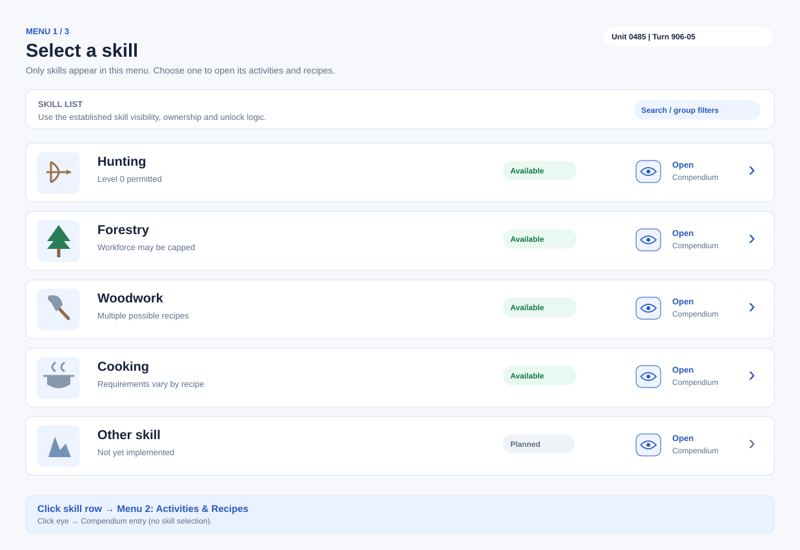
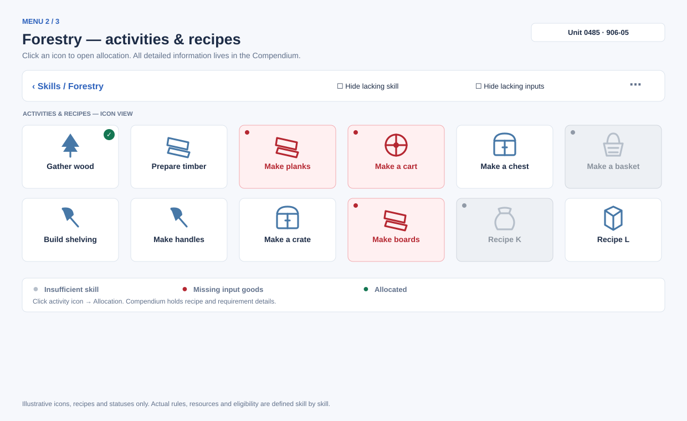
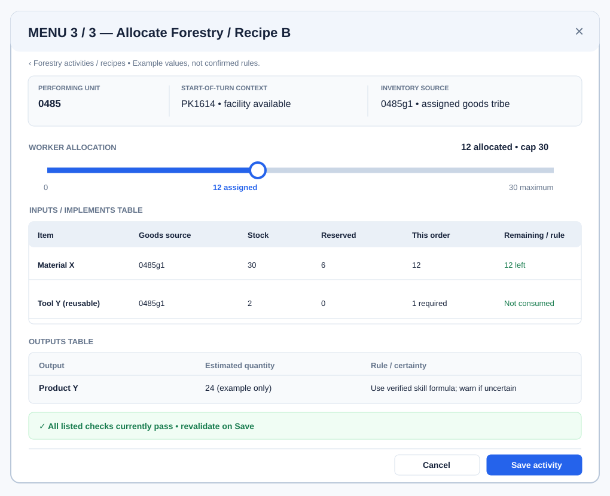
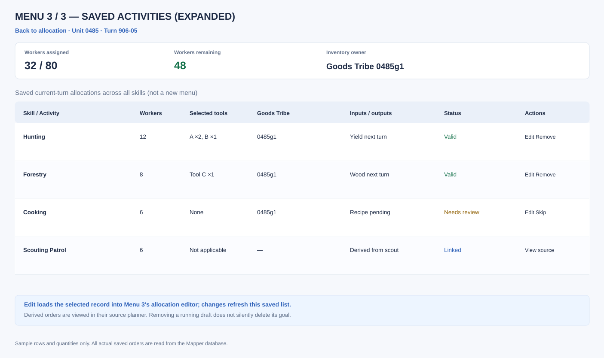
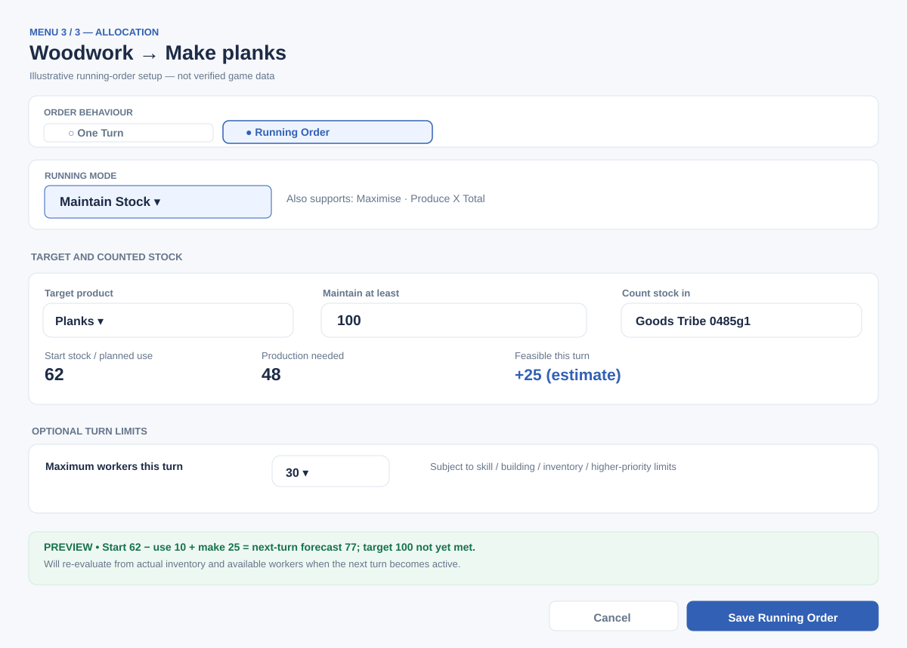
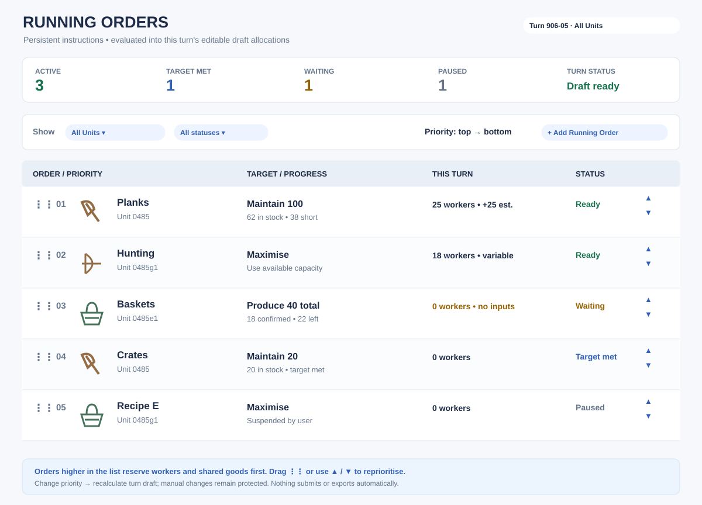

# TribeNet Manager — Activities Window & Skill-by-Skill Rollout

**Design version:** 0.9 — selected-unit Turn Action, turn-wide Activities Overview, Hunting pilot  
**Updated:** 29 October 2026  
**Status:** Proposed design, not an implementation-complete claim  
**Related designs:** [Orders Workbook Lifecycle & Export Safety](orders-workbook-lifecycle-design.md), [Compendium](compendium.md), [Compendium Skill Dossier Baselines](skill-dossier-baselines.md).

## 1. Purpose

The Mapper's **Activities Window** is a **three-menu workflow**. **Menu 1** is a compact skill icon grid; **Menu 2** shows the chosen skill's activities/recipes; **Menu 3** combines the detailed allocation editor **with a separate Saved Activities area inside the same menu**. The editor includes **Auto Allocate Tools** for automatically selecting the best verified available implements. Detailed recipe/rule browsing remains in the Compendium.

The **Running Orders** extension allows recurring production goals across turns and is configured from Menu 3, while a separate manager controls priorities (see §3B). The implementation is **incremental, one skill at a time**. Do not build every skill in one pass or expose a skill as fully supported simply because it appears in an existing catalogue. Each skill must be checked end-to-end before starting the next.

### Agreed principles

1. **Skill-driven scope:** Only activities linked to a skill and/or that skill's recipes are presented here. Other order types keep their appropriate specialist interfaces.
2. **Compendium consistency:** Each Compendium skill has a unique icon that is reused in Activities. The Compendium entry and rule data are reviewed and updated whenever activity support for that skill is added.
3. **Per-skill rules:** Level-zero availability, maximum workers, unit eligibility, resources, recipes and other conditions differ between skills. Hunting is an example of an activity available with level-zero Hunting.
4. **Multiple assignments:** A unit can perform several activities in the same turn, drawing from shared pools of workers and available goods, while observing individual skill/activity limits.
5. **Start-of-turn context:** Some skills depend on the unit's **location at the start of the turn** and the buildings/facilities in that area; use the required time snapshot, not automatically the unit's planned end position.
6. **Goods Tribe:** A linked unit **consumes all required goods from its Goods Tribe and adds all produced goods to that same Goods Tribe's inventory**. Goods Tribe assignment remains a separate workflow; Activities must use the resulting shared pool for both input and output.
7. **Turn-boundary inventory:** Production in turn N **cannot serve as input to other turn-N activities**; it enters the following turn's available activity-input inventory after reconciliation. **End-of-turn provisions eating is a distinct phase after Hunting and movement**, and must be included in food-reserve forecasts. Maintaining stock takes account of **feasible consumption across all tasks in the turn**, without inventing same-turn production chains.
8. **Saved Activities is inside Menu 3:** All current-turn saved allocations for the selected unit, across skills, are accessible in a dedicated panel/tab **inside Menu 3**, not in a separate Activities overview window.
9. **Auto Allocate Tools:** The renamed tool-selection button chooses the best verified available implements for the current activity and workers. Hunting Running Orders **automatically select tools afresh every turn**, allocating scarce Goods Tribe implements across multiple units in **Running Order priority**. A One Turn suggestion remains editable and requires explicit Save.
10. **Saved plan is authoritative:** The Mapper database owns the orders; export reads them but never clears them. A fresh blank Orders workbook is always used for each export.
11. **Skill level indicator:** Every Menu 1 skill tile shows a small circular **numeric badge at the bottom-left**, reflecting the selected unit/Tribe's effective level (including 0).
12. **Carrying-weight preview:** The selected unit's **Cargo & Equipment** tab shows current and projected **pre-movement** weight/capacity from all saved activities and BM Transfers, before the end-of-turn provisions are consumed.

## 2. Skill rollout contract — required for every new skill

A skill is considered ready only when all relevant items below are complete. Some rule categories can legitimately be 'not applicable', but this must be established for that skill rather than assumed.

| Area | Required per-skill work |
|---|---|
| Identity and assets | Canonical skill name/key, **unique skill icon**, full name, any aliases, matching Compendium article |
| Inputs and outputs | Identify all applicable consumed inputs and produced outputs; use their **existing item/goods icons** when available, adding icons when missing |
| Eligibility | Establish whether level 0 is allowed, which skill level applies (unit, tribe or mixed), prerequisite levels, research, unit type and other restrictions |
| Workforce | Maximum workers, cap grouping across recipes, workforce class, special exceptions, and actual available headcount |
| Geography and facilities | Whether the rule uses start-of-turn hex/terrain, buildings in the area, their capacity, season and other location restrictions |
| Goods Tribe inventory and turn timing | Input goods come from the acting unit or its Goods Tribe, **and outputs go to that same inventory owner**. Current-turn production is not current-turn available stock. Stock maintenance includes all current-turn consumption |
| Activity/recipes | Each supported variant, correct requirements, conversion/output rules, tool/implement compatibility, benefit limits and workbook activity/item/distinction mappings |
| UI | Three menus: compact skills icon grid; compact skill activities/recipes grid; **Menu 3 allocation editor + internal Saved Activities area**, including **Auto Allocate Tools**. Grey/red tile statuses and hide toggles in Menus 1/2 |
| Compendium | Update the skill's article with the same eligibility, worker limits, recipes, inputs/outputs, modifiers and source links |
| Persistence and export | Save/edit/delete or source-derived order handling, reload after restart, re-export safety, no duplicates |
| Tests | Level-zero/boundary cases, cap, missing goods, buildings/start position, **tool optimality and shared reservations**, Saved Activities edits, workbook output |

### Proposed implementation sequence

1. Select the **one skill** to implement and review its Mandate/Compendium rules and research unlocks.
2. Confirm the rule contract, including level-zero behaviour, skill owner, workers, starting location, buildings and inventory source. Where game documentation is ambiguous, flag the question before encoding a rule.
3. Add/reuse the shared **skill icon**; reconcile icons for its inputs and outputs with the item catalogue.
4. Update its Compendium dossier, linking relevant items, buildings, recipes, other skills, research and exact Mandate sections.
5. Implement the skill-specific activity/recipe definitions, calculations, eligibility checks **and any verified implement optimiser rules** behind a reusable validation interface.
6. Connect Menu 3's **Saved Activities panel**, selected implements, saved planning data and precise Orders workbook mappings.
7. Exercise its complete test matrix and regression-test already completed skills.
8. Only then classify that skill as **implemented and verified** and move to another skill.

This approach allows small releases and practical player testing of each skill rather than a large catalogue with inconsistent mechanics.

## 3. Activities — three-menu navigation and compact icon views

The Activities workflow is **three distinct menus**, with no combined skill/recipe browser:

```text
Selected unit → Turn Actions → Activities
  └─ MENU 1 — Skills icon grid
       └─ Click skill → MENU 2 — Selected skill's activities/recipes icon grid
            └─ Click activity or recipe → MENU 3
                 ├─ Allocation editor + Auto Allocate Tools
                 └─ Saved Activities (same menu)
                      └─ Save → refresh this area

Compendium eye on a skill icon → That skill's Compendium entry
Back from Menu 3 → Menu 2; Back from Menu 2 → Menu 1
```

**Menus 1 and 2 use a compact File Explorer-style icon grid** with names underneath. **Menu 3 contains both the allocation editor and a separate internal Saved Activities panel/tab.** There is no fourth menu in the unit-editing sequence or separate unit-scoped Saved Activities screen. A **turn-wide Activities Overview** is available from the Mapper's map-corner overview controls (independent of selected unit); the dedicated **Running Orders manager** remains separate for long-term priorities.

### 3.1 Shared context and icon-grid rules

**Primary entry point: select a unit on the Mapper and choose `Activities` in that unit's `TURN ACTIONS` toolbar**, beside Move, Split, Transfer and Scout. This passes the exact initiating unit code and opens **Menu 1**. The unit's Orders tab can forward to the same Turn Action. Carry the same unit, canonical planning turn, existing saved orders and calculated reservations through all three menus. **Do not silently return** if the selected unit or turn cannot be resolved: open the interface and show a clear actionable reason.

**Secondary entry point: `Activities Overview` in the map-corner overview toolbar** (alongside Transfers, Scout and Units) opens a **turn-wide overview**, even when no unit is selected. It shows the saved `Tribes_Activities` rows for all units and provides actions to open a unit's Activities editor or navigate to the separate Running Orders priority screen. If no planning turn or saved activities exist, display explicit empty-state guidance. The overview is not Menu 1, does not silently depend on unit selection, and does not replace Menu 3's Saved Activities panel.

**Common icon-grid design for Menus 1 and 2:**

- Compact, uniformly sized icon tiles arranged **left to right, wrapping into multiple columns and rows**, similar to File Explorer's medium/large icon view. Target approximately **six columns at the illustrated desktop width**, with responsive column count as the window changes size; avoid the former full-width rows and large cards.
- Each tile displays **one icon at the top and a readable name underneath**. There is no permanent paragraph of metadata or detailed information panel inside a tile.
- **Menu 1 level badge:** a small circle at the **bottom-left** of each skill tile displays the selected unit's effective skill level, including level **0**. Resolve unit-vs-parent-Tribe skill ownership by verified rules, and explain that source on hover/focus. Show `?` for unknown levels instead of inventing a zero. The badge remains visible on disabled/grey/red tiles.
- Long names should wrap to a sensible second line or truncate with the full name available on hover and keyboard focus. Grid tile spacing and keyboard navigation must remain consistent.
- **Normal icon:** available under the current rules. **Greyed-out icon/name:** lacks the required skill or required skill level. **Red-tinted/red icon/name:** lacks required input goods. Two independent checkboxes, **Hide lacking skill** and **Hide lacking inputs**, can hide those tiles **in either Menu 1 or Menu 2**.
- Colour is never the sole signal: each restricted tile has an accessible status name (and an unobtrusive indicator/tooltip). The filters operate on eligibility classification, not on colour alone.
- If **both** skill and input are missing for one option, classify it as **lacking skill (grey)** first; once the skill condition is met, show **missing input (red)** if it remains relevant. This prevents an unattainable recipe appearing merely as a stock shortage.
- A tile with **at least one currently usable activity** remains normal even if some of its other activities/recipes are blocked. In Menu 1, grey a skill only when no implemented activity is skill-eligible; red it only when at least one is skill-eligible but all otherwise-permitted activities require unavailable inputs. Do not turn an entire skill red solely because one of several recipes lacks goods.
- Other blockers (e.g. start-hex buildings, terrain, special worker limits, research or an unimplemented skill) are **not mislabelled** as a missing skill or missing goods. Use a discreet separate unavailable/planned indicator if required, with exact rules explained by the Compendium and save validation. Never allow an invalid assignment to be saved.
- For inputs, check **confirmed turn-start inventory** of the effective Goods Tribe (or acting unit if unlinked), less all same-turn reservations. Planned production is **not** available for same-turn consumption. Goods produced are credited to the same Goods Tribe in the **next-turn** forecast.
- **Level-zero exceptions are rule-driven**: e.g. Hunting at level 0 must not be greyed out merely because its skill level is zero.
- Changing a filter affects **display only**, never deletes, alters or unallocates saved orders. If filtering leaves no tiles, explain the empty state and allow filters to be cleared.

### 3.2 Menu 1 — Skills icon grid

**Purpose:** Select the skill. **Only skills appear here** — no activities, recipes, ingredient table or allocation controls.

- Populate the icons using **established skill-list/ownership/availability logic**, reconciled per skill. The implementation state is separate from the player's skill level.
- Every skill uses its **unique shared Compendium icon**, displayed above its full name. Hovering reveals its full name; the **bottom-left numeric skill-level circle** remains visible at all times.
- A **small eye** appears in the top-right of the hovered/focused skill tile. Clicking it **opens that skill directly in the Compendium**, without selecting the skill or entering Menu 2. The eye is keyboard accessible with an explicit label.
- Clicking anywhere else on a skill tile opens **Menu 2**, scoped to that skill. Grey/red may communicate current inability to perform activities, but the tile can still be selected to see which activities exist; no invalid allocation can be saved. The eye remains accessible even on an unavailable skill.
- Both **Hide lacking skill** and **Hide lacking inputs** toggles are available above the grid. Skills hidden by either toggle may be restored by switching the filter off.
- A skill with no implemented activity should be clearly **Planned / Not implemented**, not deceptively shown as lacking player skill; it cannot create orders until verified.

### 3.3 Menu 2 — Activities and recipes icon grid

**Purpose:** Select **what to do with the chosen skill**.

- Show **only activities and recipes associated with the selected skill** in the same compact, multi-column icon grid as Menu 1. Use item/output icons when appropriate, with names **underneath**.
- Top navigation displays **Back to Skills**, the selected skill name, and both filter toggles.
- **Grey out** individual recipes/actions lacking a requisite skill or level; **show red** those whose required inputs are unavailable from the applicable own/goods-tribe inventory; normal styling for currently available items. Apply the same priority rules and level-zero exceptions as Menu 1.
- An available activity/recipe may have a small, unobtrusive **already allocated** marker, not a large row or status panel.
- **Do not display a comparison table, requirements sidebar, details pane, or hover information card here.** Browsing the detailed descriptions, mechanics, prerequisites and full recipes belongs in the **Compendium**. Keep concise tooltips to the icon's name/status; they do not replicate the Compendium article.
- Clicking an activity/recipe opens **Menu 3 — Allocation** for that specific choice. A blocked recipe may still be opened to inspect allocation constraints, but saving remains unavailable until requirements are met; full reference material stays in Compendium.
- Recipe identities and secondary skill prerequisites must be stable and deduplicated so an item listed under multiple related skills never creates duplicate orders.
- The two hide filters on Menu 2 affect only its grid. Filter states may be retained while navigating back/forward for convenience and must never alter saved orders.

### 3.4 Menu 3 — Allocation editor and internal Saved Activities area

**Purpose:** Configure the selected activity while keeping all of the selected unit's **current-turn saved activity orders** readily visible and editable **inside the same Menu 3**.

**Layout:** Desktop Menu 3 is a single workspace with two visually distinct areas: an **Allocation Editor** (main/left pane) and **Saved Activities** (right-side pane). On smaller windows, use an **Allocation | Saved Activities** tab or collapsible panel **within Menu 3**. The Saved Activities area can expand inside Menu 3; it must never require a separate standalone window or fourth menu.

**Allocation Editor**

- Breadcrumb **Skills → [Skill] → [Activity/Recipe]**, plus **Back to Activities**. Unit, turn, worker availability, start-of-turn terrain/buildings, skill level and effective Goods Tribe remain visible as relevant.
- **One Turn | Running Order** choice, worker slider and numeric input, inputs/implements from **confirmed turn-start goods**, outputs projected for next turn (credited to Goods Tribe), and validation messages.
- Show an **Implements / Tools** section with item icons and editable quantities plus **Auto Allocate Tools** and optional **Clear** buttons. **Auto Allocate Tools optimises implement selection** for the selected activity; it does **not** choose a production goal or change the worker count.
- When clicked, Auto Allocate Tools selects the best **available, eligible combination and quantities** under verified per-skill rules, including benefits/caps, required primary/support combinations and other activity reservations. Show a short **Selected tools / effective benefit** summary; let the user freely amend selections before saving.
- **Save** revalidates against the latest plan, persists the allocation, **stays in Menu 3**, and immediately refreshes the Saved Activities list and resource/worker totals. To choose another recipe, click **Back to Activities** to Menu 2.
- **Back, Cancel and Close** discard only uncommitted changes, never existing saved activities or Running Orders. Specialist-derived rows remain owned by their specialist planners.

**Saved Activities (inside Menu 3)**

- Distinct heading **Saved Activities**, count of saved rows, and **Assigned / Available workers** for the selected unit and turn. The list includes saved orders across **all skills**, regardless of the activity being edited, and is not affected by Menu 1/2 hide filters.
- Compact rows show **activity/skill**, allocated workers, **selected tools (summary)**, One Turn / Running-generated / Manual override / Derived status and a clear validation warning if needed.
- **Edit** loads a saved activity directly into the Menu 3 editor, switching its skill and recipe context without leaving Menu 3. **Remove** asks for confirmation and removes only user-authored orders. For Running-generated rows, offer **Skip this turn** or **Edit Running Order** without silently cancelling the persistent goal. **View** a derived scouting row in its authoritative planner.
- After saving/editing/removing, refresh worker, shared Goods Tribe stock and tool reservations and running-order previews. **Exclude the row being edited from its own previous reservation** when computing what it can use; avoid double allocation.
- **View All / Expand** opens a larger saved-orders table **inside Menu 3**, returning to the prior editor without losing its state. On small windows, the Saved Activities tab is a way to navigate **within Menu 3**.
- If no activity is selected (for example, the user chose a shortcut to Saved Activities), show an editor placeholder and open Menu 3 focused on Saved Activities; do not require creating a dummy activity.
- Do not silently hide a saved order due to missing skill, missing goods, a new Goods Tribe assignment or an invalid plan; show the conflict for correction.

**Saved Activities vs Running Orders:** This in-menu area manages the **current turn's saved allocations**, including recurring-order generated drafts. The **separate Running Orders manager (§3B)** manages **persistent cross-turn instructions and priorities**, not the Saved Activities list.

### 3.5 Navigation and actions

| User action | Result |
|---|---|
| Click selected unit **Turn Actions → Activities** | Open Menu 1 — Skills icon grid for that exact unit, with planning turn context. |
| Click map-corner **Activities Overview** | Open turn-wide saved activities list, with no selected unit required; empty/error state must be visible rather than no-op. |
| Open unit from Activities Overview | Open Menu 1 for the chosen unit, retaining the planning turn. |
| Click skill | Menu 2 — activities and recipes icon grid for that skill. |
| Click activity/recipe | Open **Menu 3** allocation editor, with **Saved Activities visible in its own pane/tab**. |
| Click eye on skill | Open skill Compendium entry, not Menu 2. |
| Click **Auto Allocate Tools** | Preview/populate optimal permitted **tool mix**, subject to skill rules, inventory and existing reservations; no save until confirmed. |
| Manually edit suggested tools | Keep edits and update effective benefit/output preview. |
| Save allocation | Save only after validation; **remain in Menu 3** and refresh Saved Activities. |
| Edit/remove Saved Activities row | Act **within Menu 3**; confirm removal, handle source-derived rows appropriately. |
| Expand Saved Activities | Open a larger **within-Menu-3** table/tab, not a separate screen. |
| Open unit's Saved Activities shortcut | Open **Menu 3 focused on Saved Activities**, with neutral editor until a row is chosen. |
| Back/Cancel from Menu 3 | Return to Menu 2 without saving uncommitted edits. |
| Back from Menu 2 | Return to Menu 1; saved orders unchanged. |
| Manage Running Orders | Go to the separate long-term priority screen (§3B), not a Saved Activities overview. |

## 3A. Visual design — Menu 3 split workspace

These wireframes illustrate design only; quantities, tool choices, recipes and benefits are **examples**, never asserted game values. **Menus 1 and 2 remain compact File Explorer-style icon grids.**

### 3A.1 Menu 1 — Skills icon grid



### 3A.2 Menu 2 — Activities/recipes icon grid



### 3A.3 Menu 3 — Allocation editor and Saved Activities side by side



**Allocation inputs/implements table:**

| Column | Purpose |
|---|---|
| Input / Tool | Existing item icon and name; distinguish consumed ingredients from reusable implements. |
| Goods Tribe / stock | Owner of goods used and produced; confirmed **turn-start** available inventory only. |
| Reserved / free | Existing allocations across all units sharing that pool; do not double-count the edited row. |
| Selected | Consumable requirement or **editable chosen implement quantity**. |
| Benefit / cap | Verified per-tool contribution, quantity limits and combined skill-specific benefit cap; surplus tools are not assigned without benefit. |
| Status | Skill/research requirement, compatibility, missing goods, prior reservations or validation. |

**Tool controls:** **Auto Allocate Tools** (separate from Running Order **Maximise Production**), optional **Clear Tools**, live total implement bonus and explanation when the requested tool set is not available. Clicking Auto Allocate Tools does not save a row; Save revalidates and commits.

**Outputs:** Product icon/name, forecast next-turn amount, **Goods Tribe destination**, output certainty. No same-turn spending of goods produced.

**Saved Activities panel:** compact current-turn list with skill/activity name, workers, selected tools summary, source/status, **Edit/Remove/View** controls and worker totals. Keep all skills visible here, including invalid orders. **View all** expands **within Menu 3**.

### 3A.4 Expanded Saved Activities inside Menu 3 (not a new menu)



| Column | Purpose |
|---|---|
| Skill / activity | Saved records across all skills for the selected unit/turn, including derived rows. |
| Workers | Allocation and total committed workforce. |
| Tools | Selected implement names and quantities; details on edit. |
| Goods Tribe | Source of inputs **and** destination of outputs. |
| Inputs / next-turn outputs | Goods reserved now and projected production for following turn. |
| Status | Valid, waiting, needs review, conflicting or derived. |
| Action | Edit within Menu 3; remove user-created order with confirmation; view authoritative planner for derived orders. |

### 3A.5 Presentation rules

- The **Saved Activities area belongs inside Menu 3**, never as a separate Activities overview screen. Its compact and expanded presentations read **the same saved database records**.
- **Menu 3 Save remains in Menu 3**, refreshing saved rows and totals. Use Back to Activities to pick a new recipe.
- **Auto Allocate Tools is a tool selection helper**, not the recurring **Maximise** mode and not an instruction to allocate maximum workers.
- Every proposed tool must be genuinely available at turn start from the right Goods Tribe pool, eligible for this skill, within its stacking/quantity benefit cap and not already reserved by another order.
- No duplicate item reservation from the row currently being edited. Saved activities are always visible even when no current recipe is selected.
- The Compendium holds detailed recipe/tool reference material; Menu 3 shows only enough rule/result information to explain and validate allocations.

---

## 3B. Running Orders — persistent goals, automatic turn planning and priorities

**Status:** Proposed extension to the Activities design. Running Orders are a **separate persistent instruction layer**, not an alternative format for completed Orders workbooks. The familiar **Menu 1: Skills → Menu 2: Activities/Recipes → Menu 3: Allocation** flow remains intact. A new **Running Orders** management screen handles priorities, suspension and cross-turn progress. This concept is inspired by RimWorld's *Do until you have X*, *Do forever* and bill-ordering patterns, adapted to TribeNet's discrete turns: <https://rimworldwiki.com/wiki/Bill>.

### 3B.1 Core interaction: straightforward defaults, advanced control when needed

From **Menu 3 — Allocation**, offer a prominent choice:

| Choice | User experience | Persistence |
|---|---|---|
| **One Turn** | Existing specific worker allocation for the selected activity. Simple numeric input/slider. | Saved to the **current turn only**. |
| **Running Order** | Select a clear goal mode, optional cap, and see a preview of what is feasible **this turn**. | Persistent goal plus separately evaluated **per-turn draft allocations**. |

On first opening Menu 3, default to **One Turn** to avoid accidentally creating permanent instructions. When the user chooses Running Order, reveal only fields relevant to its selected mode. Hide complexity until needed: **Advanced** may expose optional worker cap, target-count stock source, resume threshold, etc. The existing per-skill Compendium remains the reference for recipe rules; this editor should concentrate on **what the player wants done**.



*This wireframe focuses on the **Running Order settings portion** of Menu 3; the separate **Saved Activities pane/tab is still present within Menu 3**, as shown in the main Menu 3 wireframe (§3A.3).*

**Recommended goal modes:**

| Goal mode | Plain-language label | Rule | When to stop or restart |
|---|---|---|---|
| **One Turn** | “Assign workers this turn” | Fixed people for this turn, subject to validation. | Never repeats. |
| **Maintain Stock** | “Start next turn with at least X” | Account for **all feasible same-turn consumption** from the output-receiving Goods Tribe inventory (or own inventory), then allocate enough feasible production to meet the next-turn target. | Idle when **projected next-turn stock after consumption** meets X; resume when further use creates a shortfall. |
| **Maximise** | “Produce as much as possible each turn” | Use all feasible **remaining** workers, valid tools/facilities, and eligible goods after higher-priority reservations, subject to any optional user cap. | Continues until manually paused, removed, or unable to produce. |
| **Produce X Total** | “Produce X in total, then finish” | Track **confirmed cumulative output attributed to this order** across turns, not just stock currently held. Allocate feasible work toward the remaining quantity. | Mark **Completed** when the confirmed quantity is produced; do **not** reactivate merely because goods are consumed later. |

**Recommended minimum viable modes:** One Turn, Maintain Stock, Maximise. Produce X Total is valuable but depends on **reliable actual-output attribution** in Results; implement it only once progress can be reconciled confidently. If Results do not identify production attributable to an order, keep it **Needs review** rather than guessing from planned output or total stock change.

**Example only:** Unit 0485's Goods Tribe starts with 62 Planks, and all other linked tasks use 10 this turn. **Maintain 100** requests **48** Planks of production; if only 25 is feasible, the forecast is **77** for next turn (62 − 10 + 25). This forecast is not confirmed output and cannot be used this turn.

### 3B.2 Maintain Stock — production must replace all same-turn usage

**Confirmed mechanics:** Anything produced during a turn is unavailable to use during that same turn. A unit assigned to a **Goods Tribe consumes all goods from that Goods Tribe and adds all production to it**. The stock being maintained is the **inventory pool that receives the output** — normally the Goods Tribe's pool, otherwise the acting unit's own pool.

**Meaning:** **“Try to begin the next turn with at least X of this item after everything being used this turn has been deducted.”**

```text
Next-turn forecast
  = confirmed turn-start stock
    − feasible consumption from ALL tasks this turn
    + projected production this turn (available N+1 ONLY)
    + verified net stock changes effective by next turn

Production needed by this Maintain Stock order
  = max(0, next-turn target
          − (turn-start stock − all feasible same-turn use
             + other planned output of this item
             + validated net stock changes))
```

| Example: maintain 100 | Quantity |
|---|---:|
| Start-of-turn inventory | 50 |
| Feasible use by all other tasks this turn | −50 |
| Remaining before this turn's production | 0 |
| **Production required this turn** | **100** |
| Forecast start of next turn, if production succeeds | **100** |

**Arithmetic clarification:** Start 50 − use 50 + produce **100** = next-turn stock **100**. Producing **150** would leave **150**, unless another 50 goods leave the pool. This does not change the principle: the planner **must count all other current-turn usage** when determining the required production.

**Suggested compact summary:** **Goods Tribe 0485 · Start 50 · Reserved for other tasks 50 · After use 0 · Target next turn 100 · Production needed 100 · Feasible this turn 70 · Next-turn forecast 70 (unconfirmed)**.

- Sum the **feasible** turn-N consumption of all saved manual orders, specialist planners and all running orders across **every performing unit sharing the same Goods Tribe**. Include lower-priority tasks if they remain feasible after resolving stock/resource conflicts.
- Do **not** count new turn-N production when checking any turn-N activity's input availability; only confirmed turn-start stock (plus stock that is legally available at the required moment) may be consumed. **Production chains cannot use goods just manufactured in the same turn.**
- Count other planned production of the target item only when estimating **next-turn stock**, so two orders do not overproduce the same maintenance target. Do not double-count goods produced by multiple linked units.
- If start stock is 100, target 100 and 40 are planned for use, request 40 production; the target is **not met** just because the starting quantity is 100.
- Resolve competition for scarce *starting* goods in priority order; do not count infeasible consumption as completed. Recalculate maintenance targets if changed priorities or constraints alter the feasible consumption plan. Revalidate until consistent, or explicitly flag an unresolved conflict.
- Keep planned output and actual output separate. Only Results/a validated next-turn baseline confirm whether production really occurred; never use workbook export as proof.
- Display stock **in the actual Goods Tribe output destination**, not a user-selected inventory that will not receive the output. Changing the Goods Tribe assignment invalidates the old stock forecast until recalculated.
- Transfers or other changes count only where their effective-turn timing is established, and cannot be used to circumvent the no-same-turn-production rule.
- For uncertain yields, skill limits, building capacity and indivisible batches, report the **feasible allocation, estimated output and possible shortfall/overshoot**, not guaranteed completion.

**Produce X Total** remains based on verified cumulative production, while **Maximise** is bound by current-turn stock and worker limits rather than consuming new goods produced in the same turn.

### 3B.3 How Maximise decides what “maximum” means

**Maximise** must be a deterministic **best feasible allocation**, not a fixed workforce count carried into every turn:

1. Calculate available workers **of the correct workforce class** for the performing unit, after manual commitments and higher-priority generated orders.
2. Apply the skill-specific workforce limit, shared-per-skill cap, unit type, effective skill/level (including explicit level-zero exceptions), facility/building capacity, start-of-turn geography, research, season and any other verified rule.
3. Resolve required consumable inputs from the **assigned goods tribe** or own inventory, subtracting prior reservations by **every unit sharing that source**.
4. Respect any **optional per-turn maximum workers** set by the user. This cap restricts a Maximise order, but does not replace the skill's own rules.
5. Select the greatest **valid** allocation under all constraints. For non-linear/batched recipes, evaluate valid integer worker/batch counts rather than multiplying naive fractional ratios.
6. An order with no valid allocation remains **Active / Waiting** with **0 workers this turn** and a reason. The running instruction stays enabled for future turns.
7. Never assume outputs created earlier in the **same turn** are immediately available as ingredients to another order, unless the game rules explicitly support that ordering. Avoid inventing a production chain.

A Maximise order can consume all spare capacity and **starve lower-priority orders**. Say so in the preview and encourage putting essential stock targets earlier in the list.

### 3B.4 The Running Orders management screen

Add a clearly named **Running Orders** button in the turn-wide Activities Overview and within the unit Activities editor. This opens a **dedicated screen**, separate from the three-menu selection sequence. Also offer a direct “Manage Running Orders” link in Menu 3 after creating one. **The separate Running Orders screen manages long-term goals and priorities only; current-turn Saved Activities remain inside Menu 3.**



**One persistent order per row**, with the following information kept visible without opening its editor:

| Column | Description |
|---|---|
| **Priority** | Top = first claim on eligible workers and shared input goods. **Drag handle** plus **▲ / ▼** actions for mouse/touch/keyboard. |
| **Skill / activity** | Shared icon, name, performing unit and optional output item. |
| **Goal** | “Maintain 100”, “Maximise” or “Produce 40 total”, including optional per-turn worker cap. |
| **Progress / stock** | For maintain: confirmed stock / target. For total: confirmed cumulative production / target. For maximise: not applicable. |
| **This turn** | Allocated workers and expected output (when calculable), based on the **current draft preview**, never claimed as actual completed production. |
| **State / why** | **Active**, **Target met**, **Waiting: no inputs**, **Waiting: missing building**, **Paused**, **Needs review**, **Completed**, etc. |
| **Actions** | Edit goal, Pause/Resume, Duplicate (optional), Delete with confirmation; selecting the row opens the settings. |

**Top controls:** Filter by unit, skill, state or goods source; clear filtering; show counts for active/waiting/paused/target met; **Recalculate preview** and **Review this turn's generated draft**. The list is normally a **priority queue**, intentionally **not** another recipe icon grid. It is the place to assess running commitments across units.

**Prioritisation proposal:** One **canonical ordering within the clan** for all enabled Running Orders, with per-unit filters that *do not change the underlying ranking*. This provides an unambiguous result when multiple units use the same goods tribe. Items above take first claim on eligible scarce capacity; items below receive the balance. **Manual fixed orders are reserved first** as explicit user commitments, but if one conflicts with running work, mark the issue and show how the preview changes. Reordering must be previewable and **reversible**.

**Intuitive controls:** Drag to reorder, but also offer **Move up**, **Move down**, and accessible keyboard alternatives. Show the change to this turn's workforce and goods allocations before committing any replacement of existing draft rows. Allow Pause without deleting a long-term target; Delete requires confirmation. Make “target met” distinct from “paused by user” and “blocked by lack of resources.”

### 3B.5 Example running-order workflow

1. Select a unit → **Turn Actions → Activities → select skill → select activity**.
2. In **Menu 3**, switch from **One Turn** to **Running Order**, choose **Maintain Stock 100**, verify the automatically resolved Goods Tribe **input/output inventory owner**, and optionally limit workers.
3. Review the example: **62 confirmed starting stock − 10 reserved consumption = 52**, so **48 output is required**; if feasible output is only 25, forecast **77 next turn**. Save Running Order.
4. The running instruction appears in **Running Orders** with its priority, target, current status and a link to edit.
5. When the next blank Orders workbook activates the new turn, the app recalculates the **new turn's draft allocation** using that turn's verified baseline and all prior saved commitments.
6. Review the draft and export the normal workbook when ready. The app **never automatically sends orders to Ravenpost** and never treats an exported workbook as proof of actual production.
7. Import Results when available to reconcile what actually happened. Later turns use **confirmed** quantities; missing or ambiguous Results cause a warning, not fabricated progress.

A **Maximise** order follows the same flow but omits stock target fields and continually tries to use as much remaining feasible capacity as priority permits.

### 3B.6 New-turn and recalculation lifecycle

Persistent Running Orders and individual turn orders are **different database entities**:

| Record | Lifetime | Authority |
|---|---|---|
| Running Order definition | **Across turns** until paused/completed/deleted | User's long-term goal, skill/recipe, performing unit, mode, target/scope, worker cap and priority |
| Per-turn generated allocation | **One canonical turn** | A derived, editable Mapper draft row with source running-order ID and turn; can be exported like an ordinary activity |
| Actual production / stock | **Turn-specific results/baseline** | Imported Results and validated inventory data, **not** estimated output or exported files |
| User override | **One turn by default** | Explicitly edited/locked draft quantity; does not rewrite the persistent Running Order unless separately requested |

**Recommended automatic planning behaviour:**

- On activation of turn N (receipt of N's blank Orders workbook), **evaluate enabled Running Orders for N** and populate their feasible allocations in the saved **Mapper draft plan**, visibly tagged **Running / Auto-planned**. No email is sent and no workbook is exported until the user chooses Export Orders.
- Calculate from **confirmed inventory, turn-start unit positions, buildings, unit/tribe skills, available workers and goods-tribe assignments**. If any required fact is stale or unknown, flag the affected order **Needs review**, retain the goal, and do not silently promise production.
- Reserve manual fixed orders and specialist-derived commitments; resolve **all feasible consumption** across the Goods Tribe pool in priority order. Then calculate each Maintain Stock target from the **post-consumption stock** plus other production in the **next-turn forecast only**. Lower-priority consumption still affects targets if feasible. Recalculate if conflicts change planned consumption; never treat predicted output as turn-N inputs.
- Record a stable **(running-order ID, turn, performing unit, recipe)** origin so recalculation **updates/replaces its own generated draft**, never appends duplicates. Re-running a preview without changes is **idempotent**.
- Manual edits to an auto-generated turn allocation become **This-turn override / Locked**. Recalculating may show suggested adjustments but must **not silently overwrite** a locked row. Provide **Reset to Running Order** and separate **Edit Running Order** actions.
- A higher-priority order that becomes infeasible is skipped for that turn with an explanatory reason. The scheduler then considers the next eligible order instead of blocking the whole queue.
- Changes to priorities, available stock, transfers, scouting, buildings or goods-tribe assignments can trigger a **new preview**. Apply only safe non-locked changes to current-turn drafts; surface conflicts explicitly before replacing user changes.
- When a user changes the running goal, future turns follow the new definition. Already completed turns and their exports remain historical; no retroactive alterations.
- If a user moves or splits the performing unit, revalidate the running instruction's owner and context. Never silently transfer it to a new unit or evaluate at its end-of-turn position.
- **Hunting Bills always automatically run Auto Allocate Tools for each new turn**, based on confirmed stock, available workers and higher-priority reservations. When several units share one Goods Tribe, allocate eligible implements through the **clan-wide priority queue**, not independently for each unit. Preserve manual locked this-turn overrides. Other skills may offer an optional auto-tools setting when verified. Running Order **Maximise** remains the separate production goal, not a synonym for tool selection.
- **Export is read-only** with respect to Running Orders and Mapper plans. It renders a consistent saved turn snapshot onto the turn's blank Orders template and replaces that turn's existing export in its configured path.

The current code has manual/derived activity assembly and Orders export, but it does **not** establish this persistent, deterministic recurring-order engine. This section is a new feature design, not an implemented capability.

### 3B.7 Usability safeguards and acceptance tests

- **Show what will happen now:** Every Running Order displays **this turn's workers, expected output and bottleneck reason**, plus its long-term objective. Users should not have to open every allocation to know what it is doing.
- **Avoid false completion:** A Maintain Stock goal may show **“Forecast meets target”** after accounting for all feasible same-turn consumption and all planned output, but must not imply the forecast is confirmed. **“Confirmed stock”** comes only from Results/a validated next-turn baseline. “Completed” for Produce X Total is based on verified attributable production.
- **Keep goals understandable:** “Maintain 100 planks in Goods Tribe 0485g1 (start 62, planned use 10, need 48)” is clearer than “Repeat: 100”; “Maximise” must visibly indicate that it takes **remaining** capacity, not every worker regardless of prior orders.
- **Explain priority conflicts:** When Order #1 uses the last 20 **turn-start** ore from a shared Goods Tribe, lower-priority orders show **Waiting — ore reserved by #1** rather than a generic red error. Newly produced ore cannot alleviate their current-turn shortage.
- **Reorder without lost work:** Changing priorities recalculates a **preview**, not past completed turns. Manual locked changes and all saved orders remain protected.
- **Remain usable with many units:** Filters, compact queue rows, status counters, sticky table header, optional search, and full-name tooltips prevent the management screen from becoming overwhelming.
- **Make controls accessible:** Drag-and-drop is optional; keyboard/touch up/down moves, Pause/Resume and explicit status text all work independently of hover or colour.
- **Fail safely:** Invalid goods source, insufficient skill, missing facility or uncertain Results never delete a Running Order. Mark it waiting/needs review and calculate a feasible 0 rather than fabricate input or output.
- **Export once:** Generated activity orders appear in `Tribes_Activities` **once** for the performing unit, while Goods Tribe input/output ownership follows the game's verified stock mechanics. Recurring metadata itself is **not** written as extra workbook rows. Scouting orders remain derived from its planner.
- **Turn roll-forward test:** With target 100, confirmed start stock 62, and 10 planned use, request 48; if only 25 output is feasible, forecast 77 next turn (unconfirmed). When N+1 becomes active, use **its confirmed** stock and **its current-turn consumption**, not the old estimate. Starting with 100 and planning use of 40 must trigger replacement production of 40.
- **Shared Goods Tribe test:** Several performing units linked to B reserve against B's **start-of-turn stock**, with all produced goods routed into **B's next-turn forecast**. Priority reordering changes feasible consumption and recalculates stock-maintenance needs without double-counting.
- **Maximise test:** An order exhausts only the **allowed remaining** workforce and **turn-start** resources under its limits; production in the current turn cannot create additional current-turn inputs. A blocked high-priority order does not stop eligible lower-priority work.
- **Recalculation test:** Re-running the same turn with unchanged inputs produces identical proposed rows, never duplicates or clears manual allocations; a locked override remains unchanged.
- **Results test:** Missing, late or insufficiently attributable Results leave progress unconfirmed, with a visible next-step message rather than an invented total.

### 3B.8 Decisions left open for confirmation

1. **Priority scope:** Recommended **one clan-wide queue** with filters by unit, because shared goods-tribe stock can be allocated across units. Alternative is separate unit queues plus an extra inter-unit priority rule.
2. **Stock target scope:** **No longer ambiguous:** target the effective output-receiving inventory — **Goods Tribe if linked, otherwise acting unit**. The separate relationship's effective-turn timing still needs definition.
3. **Automatic roll-forward:** Recommended generate **editable current-turn drafts automatically** on new-turn activation but **never export/send automatically**. If preferred, turn this into an “Apply Running Orders” review step.
4. **Make X total:** Require attributable confirmed production. Defer the mode if Results cannot reliably identify work performed by a specific running order.
5. **Priority/manual conflicts:** Recommended manual fixed commitments reserve first, and Running Orders use remaining capacity. Expose conflicting or overridden allocations prominently.
6. **Same-turn production chains:** **Not allowed.** Turn-N produced goods are never available as turn-N inputs.
7. **Target hysteresis:** Optional “Resume below Y” / “Pause when satisfied” for later enhancement, without complicating the initial setup screen.

---

## 3C. Cargo & Equipment — current and projected weight

When a unit is selected, **Cargo & Equipment** shows both **current weight/capacity** and **projected pre-movement weight/capacity**, accounting for **all saved activities**, applicable production and consumption, and all **Before Movement incoming/outgoing Transfers**. Show a range for uncertain yields and flag the **highest projected weight** as the conservative risk estimate. Display pounds and percentage of usable carrying capacity; if a weight or timing is unknown, flag it rather than treating it as zero. Account for physical ownership correctly when a unit uses Goods Tribe stock; do not duplicate the Goods Tribe's whole pool onto every linked unit.

This is **before end-of-turn food consumption**: current-turn provisions must be carried during movement. Recalculate after changes to activities, transfers, tools, capacity or running-order priorities. The projected weight is not a confirmed Results value.

---

## 4. Rules and eligibility model

### 4.1 No one-size-fits-all skill rule

Every implemented skill declares:

- **levelSource:** unit / tribe / contextual mixed source;
- **minimumLevel or unlock rules:** including explicit level-zero access;
- **unitType / workforceClass:** who can perform it;
- **workerLimit:** none, per skill, shared across recipes, per recipe, facility-based or special rule;
- **locationRule:** whether to evaluate start-of-turn position, terrain, coastal access, season or other geography;
- **buildingRule:** facilities in the applicable area, required counts and capacity;
- **inventoryRule:** own unit / assigned goods tribe / special rule;
- **implements and inputs:** required, reserved versus consumed, and quantities;
- **output model:** yield or conversion with researched modifiers and uncertainty;
- **order mapping:** exact activity, item, distinction and supplemental workbook fields.

A missing rule must not default to a convenient permissive rule. A rule marked 'not applicable' should be an explicit determination.

**Hunting:** is a confirmed example that players may undertake with level 0. Higher skill can affect efficiency or output according to verified Hunting rules. Skill level zero must not be equated to unavailable.

**Worker limits:** Some skills have a cap; others do not, while others have a capacity determined by facilities. For shared caps, count workers already assigned to every relevant activity/recipe of that skill before accepting more. The current activity catalogue includes a 'shared per skill 10' mechanism for some skills, but its use must be verified individually; do not apply universally. Distinguish **maximum eligible workers** from **output per worker**.

### 4.2 Start-of-turn location and buildings

Some skills use the **unit's location at the start of the turn**, and the buildings/facilities present in that area, to determine whether an activity can take place and how productive it is.

- Store or reliably resolve the canonical **start-of-turn hex** for the unit and the appropriate turn's known area/building state.
- For those skills, evaluate conditions at that start hex even if a movement order later takes the unit elsewhere.
- A facility's presence is not automatically proof of free capacity: check the skill's relevant building quantity, capacity and any reservations.
- Distinguish a building's physical location from who owns it, and avoid assuming any unit may use it without a verified rule.
- If a newly created/split unit, transferred asset or building order changes the context, apply the actual effective timing specified by the relevant rule. Do not infer that a proposed end-of-turn structure can be used at turn start.
- If start location/building information is unknown or conflicting, show the uncertainty and block or warn according to the skill's verified requirements; do not silently use the selected screen's current hex.

Not every skill needs this check. Its inclusion is controlled per skill.

### 4.3 Goods Tribe — shared source AND destination

**Agreed rule:** A performing unit A with Goods Tribe B takes **all goods it uses from B**, and **all goods it produces are added to B**, not A. The relationship defines the **one inventory owner** for input and output. Its assignment UI is a separate workflow; this Activities design must consume that relationship correctly.

1. Resolve the **effective Goods Tribe / inventory owner for each performing unit and turn**, using A itself only if no Goods Tribe relationship exists.
2. For every activity, reserve **turn-start available goods** in that owner's pool. All units using B share the same inventory reservations. A cannot fall back to its own inventory if B lacks inputs.
3. Attribute **all produced outputs and by-products to B's projected next-turn inventory**, not A's inventory. This is a forecast until confirmed by Results.
4. **No goods produced in turn N may be used as inputs for other turn-N activities**, even if B receives production from several units that turn. **End-of-turn provisions eating** is a separate, later game phase and must be forecast after Hunting, Before Movement Transfers and movement.
5. Running **Maintain Stock** checks **B's inventory** if B receives the output. Sum all other feasible turn-N consumption by every unit drawing from B, and all other turn-N production credited to B in the next-turn forecast.
6. Keep **workers, skill eligibility and applicable start-of-turn buildings/location attached to the performing unit A**, rather than transferring those attributes to B.
7. Distinguish consumed inputs, reusable tools and building capacity per verified skill rules. Goods Tribe membership by itself does not move units or create Transfers rows.
8. If B changes for A, revalidate **both** inputs and outputs plus all affected Maintain Stock calculations and Running Order drafts. Protect manual overrides and saved records; do not silently change previous turns.
9. Preserve canonical acting unit ID, Goods Tribe inventory-owner ID, item, turn and allocation/forecast provenance. Invalid, ambiguous or circular Goods Tribe assignments should be flagged before save/export.
10. Workbook export uses the proper activity/unit mappings already validated for the Orders template; do not invent new columns to represent inventory routing.

**Example:** A and C both use B. B starts with 50 Planks; A uses 20 and C uses 30. A produces 60 and C produces 40, both credited **to B**. Neither A nor C can use the 100 newly made Planks during this turn. The projected next-turn stock for **B** is **50 − 20 − 30 + 60 + 40 = 100**. The result remains unconfirmed until the actual turn outcome is known.

### 4.4 Auto Allocate Tools — best available implements for this activity

**Confirmed user intent:** The **Auto Allocate Tools** button in **Menu 3** automatically picks the **optimal eligible tools already available** for the chosen activity. This is separate from the **Maximise production** Running Order mode and separate from the worker-allocation slider.

**Recommended objective:** Maximise the **verified effective benefit for the current activity and selected worker count**, not the number/value of tools. For example, if two tools provide identical total benefit and one needs fewer scarce items, select the less wasteful combination. The objective can be output, efficiency, capacity or another skill-specific measure when verified. If benefits cannot be compared, do **not** label a guessed selection “optimal.”

**Algorithm and validations:**

1. **Inventory:** Determine the acting unit's effective **Goods Tribe pool** (or its own inventory if unlinked). Only consider available **turn-start implements**. Exclude any amounts already committed to other activities **when the game's equipment-sharing rules require exclusivity**. Treat reusable tools differently from consumable inputs; do not automatically subtract every implement as consumed.
2. **Skill eligibility:** Use the skill's verified tool types, skill/research unlocks, primary and supporting implement restrictions, any per-worker allowance, equipment/facility requirements, and how the game combines tool effects. **Hunting's Compendium dossier already separates one primary implement type from support implements and shows tool-specific maximum benefits**; similar exceptions must not be flattened into a generic ranking.
3. **True benefit optimisation:** Evaluate the benefit of feasible combinations/quantities **at the current workers assigned**, including individual and aggregate caps, any diminishing returns and overlapping bonuses. Stop adding tools once no additional benefit is gained. If no valid bonus formula exists, disable the button and display **“Tool optimiser not yet implemented for this skill”** with a Compendium link.
4. **Ties and scarcity:** When combinations give the same effective result, use a deterministic tie-breaker: prefer fewer required items, then conserve tools with the least spare availability in the shared Goods Tribe pool. Do not move or take tools from other saved orders to improve this order silently.
5. **Preview, not action:** Populate the **Selected** quantity fields in the current editor and show which implements, effective benefit and caps were applied. Allow manual changes before saving. **Auto Allocate Tools neither saves an order, transfers goods, crafts implements, changes workers nor creates a Running Order**.
6. **Respect edits and refresh:** If the editor has unsaved manual tool choices, ask before replacing them with the optimiser's suggestion. Changes to workforce, tool stock, Goods Tribe assignment, research, buildings or other allocations trigger revalidation; rerunning Auto Allocate Tools recalculates from the latest effective data.
7. **Editing existing orders:** When editing a saved row, calculate available stock **without subtracting that same row's existing tool allocations twice**. Other rows' validated reservations and any user locks remain protected. Do not over-commit tools when the rule makes them exclusive across activities.
8. **Persistence and workbook export:** Save explicit implement IDs/quantities on the **current-turn activity order** and export them via the validated `Tribes_Activities` implement-number columns. The resulting workbook rows must reflect the actual saved selection, not run an optimiser during export.
9. **Recurring orders:** For **Hunting Running Orders, Auto Allocate Tools runs each turn without an opt-in switch**. Use that turn's confirmed equipment stock and reserve eligible exclusive implements by **clan-wide Running Order priority**, across all linked units drawing from a Goods Tribe. Respect manual/locked commitments, never double-reserve, and recalculate worker numbers when tools change expected yield. A manually locked override is protected. For other future skills, automatic selection may be optional when verified. This is distinct from **Maximise production**.
10. **Validation/testing:** For every supported skill, test limited stock, shared Goods Tribe claims, incompatible tool combinations, primary/support rules, caps and zero marginal benefit, researching better implements, variable worker counts, same-turn production exclusion, equal-benefit tie cases, manual overrides, stable repeated optimisation and exact workbook mapping.

**User feedback:** After clicking Auto Allocate Tools, show an inline result such as **“Selected 2 Tool A + 1 Tool B · estimated benefit +X · limited by available stock”** when a verified computation supports it. If nothing helps, say **“No additional beneficial tools available”**. Never claim optimality when data is incomplete.

## 4A. Per-skill implementation specifications

**Permanent structure:** Maintain a **separate numbered subsection for every skill** implemented in the Activities system. Each subsection must be independently reviewable and cover: Mandate/Compendium sources and revision; eligible unit types and minimum skill; worker class and caps; selectable activities/recipes; inputs and goods-owner rules; outputs and uncertain production; equipment/research effects and Auto Allocate Tools eligibility; turn-start terrain/building requirements; Running Bill goals and priority behaviour; available one-turn/manual controls; movement/weight implications; exact `Tribes_Activities` and any supplementary workbook mappings; UI states and errors; and skill-specific acceptance tests.

**Shared rules live in §§2–4:** A skill subsection must reference the shared persistence, turn timing, Goods Tribe, priority, Cargo & Equipment and workbook rules rather than silently redefine them. Skill-specific exceptions must be explicit. Mark each feature **Implemented**, **Partially implemented** or **Planned** independently, so a UI preview cannot be mistaken for a finished export mechanism.

**Rollout order:** Hunting is **4A.1**, and new skills will be appended as **4A.2**, **4A.3**, etc. without merging their rules into a single generic recipe description.

### 4A.1 Hunting — first skill pilot

**UI entry point:** unit `TURN ACTIONS → Activities` opens Hunting through Menus 1–3. The turn-wide `Activities Overview` is accessible without a selected unit and links to the unit editor. Neither entry point may fail without visible feedback.

**Implementation status:** In progress — saved Running Bills, calculator/allocator, initial three-menu editor and workbook integration are being introduced in stages; regression tests and publishing verification must pass before declaring the pilot production-ready.


**Implement Hunting first, skill by skill.** The rule sources are Mandate N02.2 §§7.2, 8.3.1 and 13.1.15; existing Compendium Hunting dossier; existing assumption-based calculator in `src/mapper-food-gathering.js`. Hunting works at **level 0** with no skill-specific worker cap. Its variable provision yield depends on workforce, Hunting level, season/weather, terrain/water and eligible tools.

#### Provision estimate and target

- **Menu 3 displays the Hunting calculator's expected Provs range** for the allocated workers and **actually selected implements** (not hypothetical equipment). Label min/max and any fine-weather value as **estimates**, not guaranteed outcomes.
- Each Hunting Bill lets the player select **Optimistic** (highest calculator weather scenario), **Average** (arithmetic mean of the calculator's weather scenarios), or **Conservative** (lowest scenario). The chosen basis determines **how many hunters to allocate** toward the goal; always show the whole estimated range. Average is a simple scenario mean, not an asserted probability forecast.
- **Months means months remaining AFTER this turn's Provs are eaten.** The hunting work target is calculated before end-of-turn eating, including the consumption required for the current turn. Example: 700 eaters, goal 3 months → **2,800 Provs needed before eating** and **2,100 afterwards**, before considering current inventory and other supply/consumption. Population changes can make actual consumption differ.
- With a **Goods Tribe**, month calculations use **all units sharing the pool**, not just the hunter unit. Hunting Bills in one Goods Tribe with the same months target **share a single stock goal**. Higher-priority Bills try to fill it first; lower-priority Bills handle only the remaining expected shortfall, using their own yield choices.
- Hunting is never written to the workbook as an illegal conditional “stop at X Provs” order. Its export contains the planned **workers and legal implements**. Hunting output is unavailable as an input to other activities the same turn, but provisions can be eaten at the end of the turn under the game's turn sequence.

#### Tool allocation for recurring Hunting Bills

- **Auto Allocate Tools** is the UI control name. Each Hunting Running Order **automatically chooses the best legal available implements every turn** using the current turn's confirmed inventory, workers, skill/research rules, caps and reservations. This is not the separate **Maximise** production mode.
- **Shared Goods Tribe pool:** if units A and C draw implements from B, **higher-priority Running Orders reserve eligible exclusive equipment first**, and lower-priority Bills use what remains. A tool cannot be reserved for two exclusive activities; protected manual/locked plans remain protected. Reordering bills recalculates the preview, and the workforce estimate must be recalculated alongside equipment because tools change yield.
- Continue to expose the button for editable tool selection on **One Turn** activities. Do not claim an optimiser is complete for a skill until its formulas and tool combinations are verified.

#### Optional capacity percentage and automatic Provs retention

- A Hunting Bill may specify a **maximum carrying weight as a percentage of total capacity**. Calculate the Provs that fit after subtracting the **highest projected weight from all other goods and activities** and accounting for other saved **Before Movement outgoing/incoming Transfers**. Evaluate carrying weight **before eating**; **Provs are the first and initially only goods** auto-dropped. The months target continues to determine hunters; the weight limit is enforced **independently by a Transfer**, even when hunting overproduces.
- If enabled **and the hunting unit is not using a Goods Tribe**, automatically create/update a **Before Movement** `Transfers` row with **`From = To = unit`**, **`Item = PROVS`**, and **`Quantity = X`** where **X means “keep up to X Provs”**. Create it even when expected production is under the cap as protection from higher-than-expected yields. Link it to the Bill and turn, and update/delete only its own generated row without duplicates. Re-export renders the saved plan; manually edited exported Excel rows are not imported.
- **Disable the weight-cap option with a warning for any Goods Tribe-linked unit.** Do not generate a retention row; on subsequent linkage remove/invalidate that Bill's derived retention transfer, not unrelated orders.
- If the target months cannot fit after the retention limit, **weight protection takes priority**: show a shortfall warning but do **not** reduce hunters just because extra Provs may be dropped. If other cargo alone exceeds the threshold, warn instead of automatically dropping different goods. Future skills may opt into similar protection **case by case**.
- The derived **keep-only BM Transfer must execute in an order compatible with the other BM Transfers** used for the calculation. Verify the actual game/workbook execution order; until verified, show **Needs review** instead of promising a safe final load.

#### Acceptance criteria for the Hunting pilot

1. Calculator yield min/max and three yield bases; level-zero accessibility; actual selected implements and worker estimates.
2. Months target **after** eating, but full provision weight **before** eating and movement; current/projected Cargo & Equipment weight from all activities.
3. Goods Tribe has **shared eaters and shared target**; scarce tools are allocated **by running-order priority across linked units** without double reservation.
4. Auto Allocate Tools runs again each turn for every Hunting Bill; recalculation changes workers/tools together; manual locked overrides survive.
5. Weight cap automatically produces a **single BM keep-only PROVS Transfer** when not linked to a Goods Tribe, incorporating other BM Transfers and maximum non-Provs weight. Goods Tribe disables this option; no other goods are silently discarded.
6. Saved Bills, derived Transfers, `Tribes_Activities` export and `Transfers` export are idempotent, reload safely and never clear the Mapper database.

---

### 4A.2 Next skill (reserved)

Add the next skill here after Mandate review and user confirmation. Do not assume Hunting's production uncertainty, implement rules or movement-weight controls apply to unrelated skills. The shared three-menu framework is reused, while each skill receives its own eligibility, recipes, formulae, equipment, bills, workbook mapping and tests.

---

## 5. Shared resources and validation

A single turn-level reservation/validation model covers all relevant activity allocations, including allocations originating outside this window.

- Track workers by **performing unit**, workforce class and turn (including scouting/other planner commitments). Inventory, by contrast, belongs to the **Goods Tribe pool** or own unit if unlinked; never transfer worker ownership merely because stock is shared.
- Track consumables by **effective Goods Tribe inventory owner** (or own unit), item and turn, counting all linked-unit reservations against the same start-of-turn stock. Keep predicted turn-N output in a **separate N+1 forecast**, not N's spendable stock.
- Track **reusable implements/tools** and facility capacity separately from consumed goods; reserve against other orders **only to the extent required by the skill's actual sharing/exclusivity rule**, preventing false double-use without falsely treating tools as consumed. Auto Allocate Tools draws only on available eligible implements.
- Track skill-specific worker limits, building capacity and any recipe-specific limits as separate restrictions.
- Account for transfers, splits and unit creation only at their verified effective times. **Never treat goods made this turn as spendable this turn**, regardless of transfers or Goods Tribe membership.
- Every edit triggers revalidation of affected activities. Saving a different order must not erase a previously saved order that now conflicts; show a conflict and require resolution.
- Validate at presentation, save and export. Export cannot invent workers, goods or facility capacity to make an order fit.
- Use one canonical reservation source for a saved order to avoid double-counting any allocation that appears in several overviews.

## 6. Data and implementation integration

### 6.1 Existing structures to extend

The repository already includes **src/activity-catalog.js**, **src/activity-assignments.js**, Compendium skill profiles, item and Orders reference data, Mapper order management and the Orders workbook writer. These are starting points, **not evidence that all mechanics are complete**.

Prefer extending their reusable rules and catalogues rather than introducing a second, conflicting per-skill rules database in the Activities UI. Keep canonical keys for skill, activity, recipe/variant, performing unit, goods source, turn and saved assignment ID.

A skill's **implementation state** must be explicit: not yet reviewed / designed / implemented / verified. Compendium inclusion alone does not indicate an order planner is supported.

### 6.2 Persistence

- A saved assignment belongs to a canonical turn and performing unit, with activity/recipe identity, workforce allocation and other necessary order fields.
- Preserve distinct user-authored and source-derived records. Scouting remains derived from saved scouting parties; it must not be duplicated in the Activities Window.
- Keep legacy/manual activity orders readable and exportable during transition to skill-guided editing. Never delete them just because their skill is not yet implemented.
- Cancel/close without Save leaves the DB untouched.
- Reopening the window after navigation or app restart restores saved assignments.
- A changed goods source, starting-area snapshot or skill rule flags affected records for validation instead of silently rewriting them.

### 6.3 Orders workbook

Follow the separate **Orders Workbook Lifecycle & Export Safety** design without exception:

- Database = authoritative saved Mapper plan.
- Stored blank Orders workbook = turn-specific immutable template.
- Export = read-only consistent snapshot of that plan rendered onto a **fresh template copy**.
- Write the relevant **Tribes_Activities** rows using the exact validated worksheet mapping, including the required activity, item, distinction, people/workforce, implements and special fields when applicable. Any other applicable order sheet is handled by its dedicated planner.
- Re-export overwrites the **same** turn's file in **Exported Files/Orders_<turn>.xlsx** within the installation directory. Do not create numbered copies. Manual edits in the previous export are replaced, not imported.
- Export, scan, app restart and Results import must never clear activity allocations.

Scouting remains a special source-derived case: its activity is **PATROL** with **Item SCOUTING**, **Distinction NONE**, and any split-scout comment remains governed by the existing scouting design.

## 7. Compendium integration and assets

Each Compendium skill needs its own icon. Reuse that exact icon in the Activities Window, with the full name available as visible text and a hover tooltip. The eye action takes the player to the **matching skill article**, not just the Compendium home page.

As each skill is implemented, update its Compendium article to include:

- Core effect and whether it can be performed at **level zero**.
- Unit/tribe source of skill level, unlocks and prerequisites.
- Worker limits **separate from per-worker productivity**.
- Starting-hex, terrain, season and building requirements where applicable.
- Applicable inputs, outputs, implements and **their icons** (linked to the existing item catalogue).
- All supported recipes/variants; distinguish direct crafts from cases where the skill is only a secondary prerequisite.
- Research changes, exceptions, and source links to the current Mandate or research references.
- Links to relevant goods, buildings and other skills where Compendium entries exist.

The Compendium and activity logic should read the same verified structured rule definitions where feasible, while the article remains a readable explanation with citations. Do not parse article prose to compute game rules.

## 8. Per-skill acceptance checklist

For **every** newly added skill, demonstrate:

1. The Compendium and Activities Window show the **same unique skill icon**; applicable input and output goods have correctly matched icons.
2. **Menu 1 shows only skills in a compact multi-column icon grid**, each with icon above its name; hover/focus reveals the Compendium eye without triggering selection.
3. Clicking a skill opens a **separate Menu 2** with that skill's activities/recipes as a compact icon grid; selecting one opens **Menu 3** with an allocation editor **and separate Saved Activities area within the same menu**. Save stays in Menu 3 and refreshes the saved list without losing other activities.
4. Both icon menus show **grey for insufficient skill** and **red for missing input goods**, with independent toggles to hide each; validate level-zero eligibility and assigned goods-tribe inventory first.
5. A level-zero-allowed skill can be used at level 0; a restricted skill refuses ineligible levels with an understandable explanation.
6. The skill's maximum-worker rule is enforced, including across multiple recipes of the same skill where appropriate.
7. Multiple skills can be allocated together without exceeding the performing unit's shared workforce.
8. For location-dependent skills, availability and facility limits use the **unit's start-of-turn hex and area buildings**, not its planned end position.
9. For inventory-dependent skills, **all inputs come from and all outputs are credited to the assigned Goods Tribe inventory**, if linked, and multiple units cannot reserve the same turn-N goods twice. Turn-N output is not usable until N+1.
10. **Auto Allocate Tools** selects the highest effective-benefit implement combination *available* to the activity, within verified skill caps, legal compatibility, worker count and Goods Tribe stock/reservations; it leaves suggestions editable and does not silently modify other orders. Consumables and reusable tools follow their distinct rules. Maintain Stock still includes all feasible same-turn consumption.
11. **Menu 3 has a Saved Activities pane/tab within the same menu** listing all current-turn activities for the selected unit across skills, including edit/remove/source-view controls and worker/tool totals. **Saving stays in Menu 3** and updates the saved area. Optimiser selections, configuration calculations, saved records and Compendium descriptions agree with the verified source.
12. Save, cancel, edit, remove, navigation and restart preserve correct plans without phantom/duplicate activity rows.
13. Orders export produces exact activity mappings, re-export replaces the same turn's file, and nothing about export changes the database plan.
14. Existing completed skills and specialist planners pass regression tests.
15. Current/projected weight is visible in Cargo & Equipment, including all activities and BM Transfers **before eating**, and numeric skill-level badges appear bottom-left in Menu 1.
16. Hunting Bills automatically allocate tools each turn by **clan-wide priority** for shared Goods Tribe stocks, and the optional weight cap creates the correct derived BM keep-only Provs Transfer when the unit is not Goods Tribe-linked.
17. The selected unit's **Turn Actions** offers Activities, opening Menu 1 for that unit. **Activities Overview** opens independently of unit selection, lists the planning turn's saved activities, and provides meaningful empty/error states plus a route to the Running Orders manager.

## 9. Implementation order and definition of done

Begin with the reusable **three-menu navigation framework (skills → activities/recipes → allocation + Saved Activities inside Menu 3), shared icon registry, Compendium deep link, skill-aware Auto Allocate Tools engine, reservation validator and persistence adapter**. Then add a **persistent Running Orders definition store, repeat-mode editor, priority manager, deterministic turn allocator, result-based reconciliation and idempotent generated-order adapter** before enabling recurring production per skill. Complete the inventory-source abstraction and start-of-turn context abstraction early, even if first skills do not yet exercise every option. They must not be retrofitted separately into every subsequent recipe.

**Hunting is the agreed first implementation batch.** Then choose one skill per later implementation batch. For each batch: agree its rules, tools/benefit caps and icons; update its Compendium article; implement activities/recipes **and Auto Allocate Tools when applicable**; wire DB and workbook export; test saved activity editing within Menu 3, tool optimisation and all boundaries; and verify existing activity functionality. The user can then test that specific skill before the next one.

## 10. Open design decisions

These are **not yet assumed rules**; resolve them while defining the affected workflow or skill. The proposed recurring-order defaults and their exceptions are detailed in **§3B.8**:

- **Hunting is the first skill.** How many other skills should appear as not-yet-supported tiles?
- For each skill, which tool/implement benefit formula, caps, compatible combinations and exclusivity rules are sufficiently verified to enable **Auto Allocate Tools**? What is its skill-specific optimisation metric if output is not the only benefit?
- Exact empty states in Menu 1/2 and whether multi-skill recipes appear under secondary skills.
- How a unit is assigned one or more goods tribes, effective-turn rules, authorization/ownership and what happens if the source changes. The assignment UI is a separate design.
- Whether a missing goods-tribe assignment always falls back to own inventory, or whether certain skills require an explicit goods-source setting.
- Exact timing of transfers and other non-production stock changes still needs verification; **newly made goods are definitively unavailable for same-turn use**.
- For buildings: ownership/usage permissions, sharing of facility capacity and effect of planned building changes.
- What specific warnings should be non-blocking when the game outcome is intrinsically uncertain, versus hard validation failures.
- Per-skill handling for unit creation/splits, location-dependent activities and skill-ownership exceptions.

## 11. Existing code and gaps to verify

### Reusable foundation already present (not a completion claim)

- **src/activity-catalog.js:** Catalogue of activity codes, skill mapping, some level-zero flags and worker-limit types.
- **src/activity-assignments.js:** Normalization of manual activities and derived scouting reservations/comments.
- **src/compendium-*.js** and **docs/skill-dossier-baselines.md:** Skill articles/dossiers, rules descriptions and source references.
- **src/orders-workbook.js** and related export modules: Existing workbook creation and mapping flow.

### Bugs, missing features and verification still required

- A dedicated **three-menu** Activities interface (skill list → per-skill activities/recipes → final allocation) is **not yet established as complete**.
- Unique, shared skill-icon coverage and a verified Compendium eye/deep-link action need implementation/audit.
- Full per-skill recipe coverage and consistent input/output icons need phased implementation.
- **Menu 1 skill-level badges**, current/projected **Cargo & Equipment weight** and the Hunting-specific Bill/cap mechanics (§4A) need implementation and tests.
- Skill-specific **level-zero**, worker-cap and mixed tribe/unit-level validation must be checked for each new skill.
- Start-of-turn hex and area-building constraints need a reusable source, eligibility evaluator and tests.
- **Goods Tribe assignment** remains a separate future step; Activities must resolve the **same inventory owner for inputs and outputs**, reserve against turn-start stock across linked units, and forecast produced goods for the **following turn only**.
- Cross-planner workforce/stock/facility reservation and conflict handling require end-to-end tests.
- Saved edit/cancel/reload and workbook export must be regression-tested for every added skill, including re-export safety and preservation of legacy orders.
- Existing skill dossier and activity-catalog rules may require reconciliation against the latest Mandate/research before being treated as authoritative.
- **Auto Allocate Tools is not implemented:** add verified per-skill optimiser formulas, availability and reservation checks, editable suggestion UI and workbook mapping tests. Hunting Bills must auto-select tools **every turn in priority order across shared Goods Tribe inventory**.
- **Saved Activities in Menu 3 remains to be implemented:** separate in-menu pane/tab, inline edit/remove, source-derived navigation, accurate worker/tool totals and immediate refresh on Save. The older standalone overview concept is superseded.
- **Inventory timing and Goods Tribe routing still need implementation:** block consumption of current-turn production; credit every output to the effective Goods Tribe; aggregate all linked-unit feasible consumption when forecasting next-turn stock, with acceptance tests covering input shortages, current-turn use and priority changes.
- **Running Orders are not implemented:** build persistent goal/mode/priority storage, cross-unit resource-aware allocation, current-turn regeneration, stock/Results reconciliation, per-turn manual override protection, and a dedicated prioritisation screen. Verify no standing-order state is lost or spuriously treated as workbook output.
- Implement/test clear statuses for target met, insufficient inputs, priority starvation, paused, completed and Results-needs-review; add an audit trail explaining each turn's worker and input allocation.

---

**Design rule:** A skill is not 'done' merely because its icon appears. It is done only when its Compendium entry, icons, rule checks, start-location/building and goods-source behaviour (when applicable), worker/resource allocation, saved orders and workbook export agree and have been tested.
