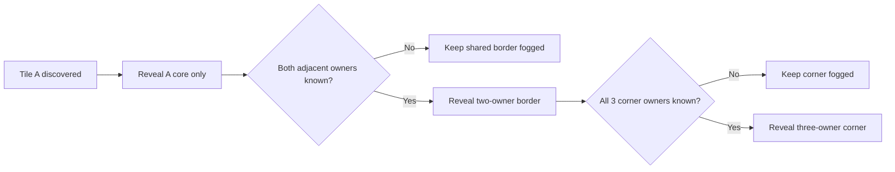
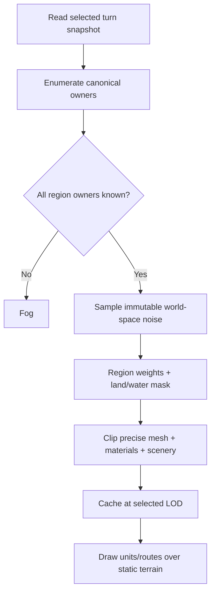

# Hex Terrain Generation & Unit Placement — Design v1.0

**Project:** TribeNet Manager  
**Date:** 2026-10-24  
**Status:** Technical design (not an implementation or gameplay-rule change)  
**Companion deliverable:** Illustrated 10-page design document prepared in DOCX/PDF.

## 1. Goals and invariants

Render one visually continuous 3D landscape on top of the original game hexes, while preserving source-of-truth terrain codes and strict discovery/fog boundaries.

- **Core purity:** A revealed hex's inner core is 100% its own reported terrain; later discoveries must never alter core height, colour, water identity or hill outline.
- **Region visibility:** Reveal a core with 1 known owner; a shared border only with both owners known; and a shared corner only with all 3 owners known.
- **Seam integrity:** Every shared point has an identical world-space height, material and coast classification, regardless of which tile renders it.
- **Determinism:** Seeded by immutable world coordinates and a renderer version, never turn order, machine, current time or random iteration order.
- **Game-logic separation:** Blending is visual. Selection, coordinates, terrain codes, movement costs and orders stay on the existing game hexes.
- **Unit semantics:** Scouting is not movement; an otherwise stationary scout stays in its inner-hex position.

## 2. Existing system baseline

The main branch currently uses a **flat-top, odd-column offset grid**, a **core radius of 0.62** in normalized hex radius units, relief seed `tribenet-world:relief-v2`, scenery seed `tribenet-world:scenery-v1` and software-rendered north-up orthographic projection. The current close-view ground mesh uses 16 subdivisions per wedge (1,536 base triangles per hex), falling to 8/4/2 at lower zoom. The current coastline seeks roughly a 60% flat-water apron through the mixed connector.

Existing integration points: `src/isometric-core.js` (grid, terrain and geometry), `src/isometric-mapper.js` (drawing, clipping and caching), `src/isometric-units.js` (unit presentation), and the Results playback modules. `docs/isometric-mapper.md` documents the current baseline. The formulas below are the **proposed contract**, not an assertion that they have all been implemented.

## 3. Region geometry, discovery and diagrams

Let `R` be the circumradius of the original hex; adopt `ρ=0.62` initially for the smaller inner hex. Flat-top corner k:

```text
V_k = C + R * (cos(kπ/3), sin(kπ/3)), k=0..5
InnerV_k = C + ρ * (V_k-C)
```

Current normalized odd-column centres (R=1):

```text
Cx(q,r) = 1 + 1.5q
Cy(q,r) = √3/2 + √3 (r + 0.5*(q mod 2))
```

Conceptual segmentation (not to scale):

```text
      Inner A          Inner B
        \              /
         \ [AB BORDER]/
          \    △     /
           \  ABC   /
            [CORNER]
              / \
          Inner C
```



Split every mesh triangle by exact clipping to inner-core, quadrilateral connector and triangular junction polygons. This segmentation changes **visual visibility**, not hitboxes or game-hex ownership. Evaluate border/corner ownership from canonical, sorted global coordinates.

## 4. Scale and projection

The diagram specifies **25 miles between the west and east hex vertices**. Thus R=12.5 miles; width across flats is `25√3/2 ≈ 21.65 miles`. The sketch specifies **5× vertical exaggeration**, including trees.

```text
screen-height-units = (hex-screen-width / 25 miles) * 5 * physical-height-miles
```

At a 100-unit hex width, 200 m → 2.49 height units, 600 m → 7.46, 2,500 m → 31.1, and a 20 m tree → only 0.25. The latter needs a distinct **far-zoom visual-impostor** technique if trees are to remain recognizable; do not secretly rescale physical tree geometry above 5×.

Preserve the mapper's normalized orthographic north-up view: `screenX=S*x`, `screenY=S*(0.62*y - 0.78*z)`.

## 5. Seeded elevation generation

Sample continuous world-space noise from immutable `(x,y,seedVersion)`. Use a stable integer hash and interpolated value noise or simplex noise, with broad, medium and fine frequencies.

```text
fBm(x,y) = [Σ_i a^i N(2^i*x/L, 2^i*y/L)] / Σ_i a^i
ridge(x,y) = (1 - abs(N_medium(x,y)))^γ
H_T(x,y) = max(0, b_T + A_T*fBm_broad + B_T*ridge + C_T*fBm_detail)
```

Choose `b_T,A_T,B_T,C_T,L,γ` by **authoritative terrain class**. Plains have low relief; hills receive rounded broad noise; low mountains receive connected ridges; high mountains use taller, sharper ridges, exposed rock and conditional snow. Water cores have z=0. Illustrative apparent altitude profiles (not game-supplied real elevations): hills approximately 150–600 m; low mountains 600–1,800 m; high mountains 1,800–4,500 m. Keep all actual terrain data unchanged.

## 6. Shared borders: variable two-owner weights

Along a shared A→B connector, let `u=0` at A's core boundary, `u=1` at B's.

```text
smoothstep(u) = 3u² - 2u³
wA = 1 - smoothstep(u);   wB = smoothstep(u)
H_border(P) = wA*H_A(P) + wB*H_B(P)
```

The sketch's 40% terrain A / 60% terrain B is one **example point** (at u≈0.567), not the composition of the entire connector. Smoothstep joins either protected core with zero boundary derivative.

## 7. Three-owner corner

For P inside a triangle with vertices representing owners A/B/C, compute barycentric coordinates `λ_A + λ_B + λ_C=1`. Use compatible smoothed, renormalized influence:

```text
w_i(P) = smoothstep(λ_i) / Σ_j smoothstep(λ_j)
H_corner(P) = Σ_i w_i(P)*H_i(P)
```

The sketch's 25%/25%/50% is one example at a specific corner position. Ensure that along every shared edge/corner boundary, the formulas agree exactly on height, material and categorical water classification. Sample canonical shared vertices once, by absolute world position.

## 8. Coastline model

Never average `ocean` and `land` as if water were only a paint colour. Define a separate land-share field with a continuous shoreline *within the connector*, keeping both inner cores unchanged.

```text
L(P) = Σ_i w_i(P) * I(owner_i is land)
F(P) = L(P) - τ + δ(P), with seeded |δ(P)| <= ε
water iff F(P) <= 0; otherwise land
r = clamp((L(P)-τ)/(1-τ),0,1)
H_coast(P) = H_mix(P) * smoothstep(r)^p    (land only)
```

Tune `τ` initially so about 60% of the connector from water toward land is flat water. For a direct smoothstep path, `τ≈smoothstep(0.60)=0.648`. Use bounded world-space shoreline noise that **cannot move the coast into either core**. Example exponent `p≈1.5` makes a gradual hill shore; `p≈0.5` makes a steeper mountain shore. Split triangles at the level set F=0. Water has a common z=0 plane; no dry face acquires water colour. Coastlines and river segments must not appear in still-unknown corners.

## 9. Vegetation, materials and LOD

Blend continuous properties: heights, material channels, rock exposure and vegetation density. Never blend categorical codes, movement rules or source ownership.

```text
vegetationDensity(P) = clamp( Σ_i w_i*density(T_i) * g(slope,rock,water), 0,1 )
```

Generate candidate tree points on a **global hashed jitter grid / Poisson disk**, not per-tile random walks. Accept by biome density and deterministic tests. Suppress sites on water, fog, beaches, steep rock and very small under-unit clearings. Unit motion must never remove the ground itself.

Avoid coarse cubical voxels; use a continuous sampled heightfield and optional bevelled rock layers. Keep current LOD ladder:

| View | Subdivisions per wedge | Base triangles per full hex |
|---|---:|---:|
| Close | 16 | 1536 |
| Medium | 8 | 384 |
| Far | 4 | 96 |
| Overview | 2 | 24 |

Every LOD samples the **same** world-space height/shoreline fields. Adjacent LODs either share an agreed seam resolution or are explicitly stitched. Cache immutable cores independently of owner-complete connector sections; revealing a neighbour invalidates only newly available shared areas and composites.

## 10. Units

Stationary units occupy six numbered inner-core slots in this order: **1 N, 2 NE, 3 SE, 4 S, 5 SW, 6 NW**, initially about 0.33R from the centre. Use a stable unit ID/hash for assignments; overflow units can take secondary-ring or clustered slots with a tooltip.

Moving units sit near the **edge facing the next destination hex**, with lateral lanes **A/B/C** for multiple units along the same edge. During playback, interpolate world coordinates continuously through departure, crossing and arrival, sampling the actual terrain height. A planned route must not duplicate a model at both ends. Scouting alone leaves the unit in its stationary slot.

```text
stationarySlot_j = C + r_s (cos(π/2-jπ/3), sin(π/2-jπ/3))
movingLane_k = sharedEdgeMidpoint + t_k*edgeTangent; t_k∈{-d,0,+d}
```

## 11. Pipeline and pseudocode



```js
for (const region of visibleRegions) {
  if (!region.owners.every(isKnownInSelectedTurn)) {
    paintFog(region);
    continue;
  }
  const key = canonicalRegionKey(region, terrainCodes, rendererVersion, lod);
  draw(cache.getOrCreate(key, () => buildClippedRegion(region, sampleWorld)));
}
// Units and moving/scouting overlays rendered as separate passes.
```

## 12. Mandatory regression tests

1. **Reveal permutation:** A→B→C, C→B→A and all-at-once end with the same fully known map.
2. **Protected core:** Sampled core heights/materials are identical before/after neighbour reveal.
3. **Fog:** Unknown border and corner sections show no invented terrain.
4. **Watertight seams:** Shared vertex heights, colours and shoreline crossings match across ownership.
5. **Coastal confinement:** Land-core/water-core identity never changes; coasts live in unlocked shared connectors.
6. **Deterministic hash:** Same turn and version match across app restart/installations.
7. **Scale:** 25-mile horizontal and 5× vertical geometry calculations pass exact unit tests.
8. **LOD:** Zoom changes mesh fidelity only, not terrain field or coastline classification.
9. **Units:** Stable stationary/moving lanes; scouting-only unit remains centred; no duplicate endpoints.
10. **Visual regression:** No coarse-voxel appearance, terrain disappearing under movers, pan flicker or unexpected coast bridges.
11. **Integration:** Existing movement planner, Orders export, river annotations, Results reprocessing and historical views continue working.

## 13. Implementation sequence

1. Lock geometry, ownership and scale contracts and add golden fixtures.
2. Implement pure deterministic relief and region blends.
3. Fix categorical coastline and exact mesh clipping.
4. Unify world-space materials, trees, LOD and caches.
5. Add deterministic unit slots and movement playback layout.
6. Compare screenshots to the attractive pre-coast hills and run performance/regression tests.

**Decisions still tunable:** terrain altitude palettes, exact shoreline noise and threshold, overflowing unit lanes and far-zoom tree readability. Keep `ρ=0.62`, the 25-mile width, 5× elevation and 1/2/3-owner reveal logic as the initial fixed specification.
