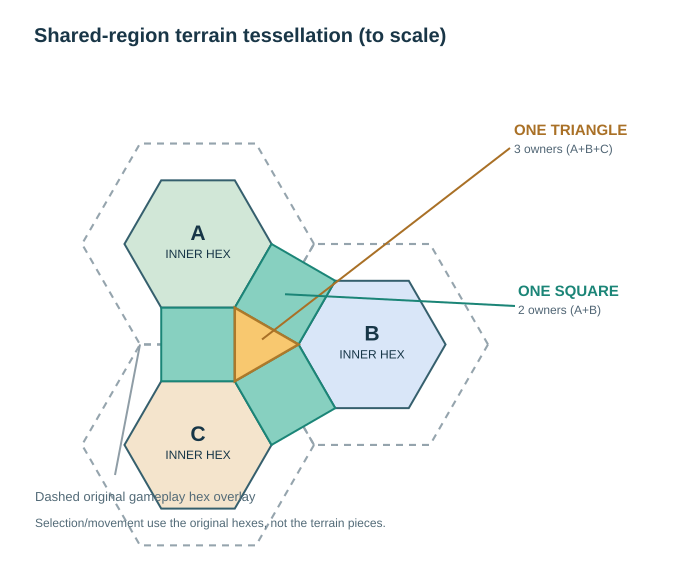

# TribeNet Manager — World Terrain Generation & Shared-Region Rendering
**Final design v1.2 · 24 October 2026 · Implementation baseline and tuning specification**

> **Precedence:** The supplied hand sketch and the latest user discussion override earlier conflicting decisions; the World Map Design discussion applies wherever compatible. V1.2 supersedes v1.1's fixed directional six-slot unit model. Physical shared-region geometry is a world-space topology; rasterising it in original-hex fragments for cache efficiency does not change physical ownership, weight fields or selectable gameplay hexes.

## 1. Design requirements

1. **The physical terrain drawing is a hexagon/square/triangle tessellation**, not a set of mini-regions clipped into separate original gameplay hexes.
2. **Original game hexes remain a separate, selectable overlay.** Gameplay hex coordinate, movement, turn history, route, unit ownership and export rules do not change.
3. **Inner hex:** 100% terrain dictated by its reported terrain code, immutable after discovery. The inner hex can have rugged relief of its own terrain, but never borrows from an undiscovered neighbour.
4. **Square:** a single globally owned shared mesh connecting **two inner hexes**, physically extending into both original game hexes. Its generation requires both owner terrain codes to be known.
5. **Triangle:** a single globally owned shared mesh touching **three inner hexes**, physically extending into all three original game hexes. Its generation requires all three owner terrain codes to be known.
6. **Terrain appears semi-realistic, irregular and jagged.** Avoid universal smoothstep hillsides, bowl-shaped uniform mounds, straight coasts and giant voxels.
7. **Permanent world-generation seed** is a single static integer derived from the repository's creation date, never from an application/release version.
8. **Seed-controlled influence percentages** vary by shared piece (with specified bounds at the piece's representative control points), but must still connect exactly to 100%-owned inner-hex edges.
9. **Preload already-discovered terrain at application startup** using nonblocking, priority-aware caching; don't invent terrain in undiscovered regions.

Additional preserved World Map Design decisions: make the map's **displayed hexes 50% larger** (not the game-world mile scale), prefer **approximately 60% water across a mixed land/ocean connector** rather than 90%, make coasts more jagged, eliminate long pan/redraw stalls, subdivide large-looking mesh facets, and keep the attractive earlier connected-hill silhouette while solving coastal blending.

## 2. Correct physical topology and separate selectable overlay

This is the **rhombitrihexagonal (3.4.6.4) tiling**: regular inner hexagons, squares between neighbours, and triangles at three-owner junctions. Unlike the erroneous earlier Figure 4, neither a square nor a triangle is split into per-game-hex shapes.

The old flat-top original gameplay hexes remain a **transparent overlay** for mouse picking and planning. Their edges cross the middle of shared squares; their vertices fall at the middle of shared triangular junctions. Selection of any point on the drawn terrain resolves to the corresponding **original gameplay hex**, never to a separate square/triangle.

### 2.1 Exact core inset and tessellation mathematics

Let an original game hex have circumradius \(R\). Its six vertices are

\[
V_k=C+R(\cos(k\pi/3),\sin(k\pi/3)),\quad k=0,\ldots,5.
\]

The concentric smaller core has vertices \(I_k=C+\rho (V_k-C)\). An original flat-top hex has apothem \(a=\sqrt{3}R/2\). For a shared connector to be a true square, its width between inner core sides must equal the length of either inner core side:

\[
2a(1-\rho)=\rho R
\quad\Longrightarrow\quad
\boxed{\rho=\frac{\sqrt{3}}{1+\sqrt{3}}\approx0.6339745962}.
\]

**Design choice:** increase the current internal core ratio **0.62 → ~0.634**, yielding proper squares and equilateral triangles. This only affects the visual tessellation; original hex pick geometry stays fixed. If an aesthetic prototype retains \(\rho=0.62\), these are *slightly rectangular quadrilaterals*, not exact squares; avoid topology gaps or overlaps.

Current original hex centre layout can remain in the existing flat-top odd-column coordinate convention:

\`\`\`js
centerX(col,row) = 1 + 1.5 * col;
centerY(col,row) = Math.sqrt(3)/2 + Math.sqrt(3)*(row + (col % 2 ? 0.5 : 0));
\`\`\`

Every game hex contributes **one** inner hex, **six half-shares of one square per neighbour** (three whole squares on average), and **six third-shares of one triangle per vertex** (two whole triangles on average). Actual meshes are **not** stored/drawn as half- or third-regions; these shares describe counts only. Deduplicate by the globally sorted 2-owner or 3-owner key.

### 2.2 Discovery

| Region | Global key | When shown |
|---|---|---|
| Inner hexagon | game-hex ID | Own game hex is known in the selected turn |
| Shared square | sorted owner hex IDs A,B | **Both** A and B known |
| Shared triangle | sorted owner IDs A,B,C | **All three** A,B,C known |

**Historical consistency:** Visibility is calculated for the selected turn, not the latest cached map. Unknown shared regions remain opaque fog, even if meshes exist from a later turn. Neither a core nor its previously rendered height, colour, water identity, ridgeline or terrain props can be reshaped when a neighbour is discovered.

\`\`\`mermaid
flowchart LR
  A["Load selected turn's known hexes"] --> B["Create/reuse known inner hexes"]
  B --> C{"Both square owners known?"}
  C -- "No" --> F["Square stays fogged"]
  C -- "Yes" --> D["Show one shared square"]
  D --> E{"All triangle owners known?"}
  E -- "No" --> G["Triangle stays fogged"]
  E -- "Yes" --> H["Show one shared triangle"]
\`\`\`

## 3. Permanent numeric seed: section 5.1 replacement

GitHub repository API reports:

- Repository: **Endalos89/TribeNetManager**
- Creation: **2026-09-26T12:16:52Z**
- Unix timestamp in whole seconds: **1790425012**

\`\`\`js
const WORLD_SEED = 1790425012; // permanent across all application versions
function stableSample(featureType, canonicalRegionKey, worldX, worldY) {
  return stableHash32(WORLD_SEED, featureType, canonicalRegionKey, worldX, worldY);
}
\`\`\`

Use one explicitly specified 32-bit hash algorithm with known test vectors (for example a pinned FNV-1a mixing contract) and stable float serialization/quantisation. Feature domains such as \`height\`, \`coast\`, \`trees\`, \`border-weight\` and \`corner-weight\` decorrelate output but **never introduce version salt**. Seeds must not depend on install ID, clock, randomly consumed PRNG state or reveal order.

**Important distinction:** A fixed seed guarantees identical random inputs, **not automatically identical terrain if the generation algorithm is rewritten**. Protect already-discovered shapes via a pinned algorithm contract and/or persisted geometry. A cache schema/version may change for invalidation, but **WORLD_SEED itself never changes**. Never silently regenerate already established terrain silhouettes with a new algorithm.

## 4. Seeded square/corner terrain proportions

### 4.1 Square (two owners): seeded 25–75% at control points

For ordered owners A,B choose \(U_{AB}\in[0,1]\) by a stable hash of the **sorted pair key**:

\[
\beta_{AB}=0.25+0.50 U_{AB}, \qquad
(w_A,w_B)_{\text{square-centre}}=(1-\beta_{AB},\,\beta_{AB}).
\]

Examples: 35/65, 58/42, 25/75. The percentage is one canonical *piece-level target*, not a constant throughout its area: A's core boundary stays 100% A and B's core boundary stays 100% B.

### 4.2 Triangle (three owners): feasible 25–50% at centroid

Three weights all **≥25%** cannot simultaneously permit one weight to reach 75%, because they must sum to 100%. Assign at the **triangle centroid**:

\[
u_i>0\quad\text{(independent deterministic owner values)},\qquad
c_i=0.25+0.25\frac{u_i}{u_A+u_B+u_C}.
\]

Then \(\sum c_i=1\) and \(0.25\leq c_i\leq0.50\). An example is **25/30/45** (or the sketch's 25/25/50). Local weights may approach 0% or 100% along edges/corners because exact continuity with pure cores is non-negotiable: the percentage bounds apply at the **representative seeded control point**, not at every mathematical point in the region.

### 4.3 Exact continuity between inner hex, square and triangle

Avoid independently interpolating a square and triangle with conflicting formulas. Use an **identical shared control-vertex graph**:

- **Square:** its two A-core vertices get \((1,0)\); its two B-core vertices get \((0,1)\). Its centre and its two *square/triangle side midpoints* receive the fixed seeded A/B pair weights.
- **Triangle:** its three core vertices have pure owner weights \((1,0,0)\), \((0,1,0)\), \((0,0,1)\). Each side midpoint receives exactly the two-owner weights of the square touching that same side (third owner 0). Its centre receives the seeded triangle centroid weights.
- Tessellate these region-control points into small triangles. On each, use **piecewise barycentric interpolation** of owner weights:

\[
w_i(P)=\sum_{k=1}^{3}\lambda_k(P)\,w_i(V_k),\quad
\sum_k\lambda_k=1,\quad
H(P)=\sum_i w_i(P)H_{T_i}(P).
\]

This is a continuous **C0** join (no height cracks), without imposing C1 derivative smoothing everywhere. It allows angular or broken geological forms. Sample any shared vertex in one canonical coordinate/owner order; a cached region must not mutate neighbour core geometry.

## 5. Semi-realistic, jagged terrain: generation method

**Do not flatten or round every landform into smooth bell hills.** The original pre-coast terrain was visually appealing; retain connected broad masses but introduce irregular ridges, ridged detail, weathered scarps and coherent coastlines.

Sample deterministic fields in **absolute world coordinates**; never seed individual tile-local noise islands that stop at their borders.

**A) Warp sampling coordinates** to avoid uniformly aligned noise:

\[
P'=P+a_w[N_{w1}(P/L_w),N_{w2}(P/L_w)].
\]

**B) Build broad and small-scale features** (normalised noise \(N\in[-1,1]\)):

\[
\operatorname{fBm}(P')=\frac{\sum_{j=0}^{n-1}a^j N(2^jP'/L)}
{\sum_{j=0}^{n-1}a^j},
\]

\[
\operatorname{ridge}(P')=\sum_{j=0}^{m-1}b^j
[1-|N(2^jP'/L_r)|]^\gamma.
\]

**C) Combine terrain-specific components**:

\[
H_T(P)=\max(0,h_{0,T}+A_T\operatorname{fBm}_{broad}(P')
+B_T\operatorname{ridge}(P')+C_T\operatorname{detail}(P')).
\]

Tune \(h_0,A,B,C,\gamma\) **by authoritative terrain code**, never infer a new code from visual noise. Hills: connected but asymmetric shoulders and isolated rock. Low mountains: fractured lines of ridges and foothills. High mountains: angular peaks, steep slopes and exposed stratified rock. Plains: low relief with gullies. Desert/brush/swamp: their own distinctive textures and relief. Oceans and lakes: flat water at sea level inside their cores. No artificial global smoothstep across every landform.

Use rock exposure proportional to slope, height and deterministic local material noise. Jagged relief is obtained from coherent high-frequency components **and enough mesh fidelity**, not from stacked cubical voxels. Optional erosion-like gullies should be local, cheap, deterministic and boundary-aware; full-world hydraulic erosion is not required at runtime.

### 5.1 Terrain-generator inspiration

- [Red Blob Games Mapgen4 — site](https://www.redblobgames.com/maps/mapgen4/), [source](https://github.com/redblobgames/mapgen4): useful model for fast JavaScript/TypeScript procedural regeneration, mountain folds, terrain shapes, noisy coasts and rivers. Its design explicitly pursues an artistic look rather than geological simulation, so adapt algorithms rather than transplanting its entire world generator.
- [FastNoise Lite documentation](https://github.com/Auburn/FastNoiseLite/wiki/Documentation): fractal noise and **domain warping** provide practical techniques for jagged silhouettes and varied texture. Any third-party code must be evaluated for licence and packaged locally; no CDN or paid service.

## 6. Coastline generation

Maintain **categorical land/water**, not an averaged blue tint. A water core remains water, a land core remains land. A mixed shared square or triangle can carry an irregular coast *only when every relevant owner is known*.

\[
L(P)=\sum_i w_i(P)\,\mathbf{1}_{T_i\text{ is land}},
\quad F(P)=L(P)-\tau+\delta(P)\,E(P).
\]

- \(\delta(P)\) is bounded, world-space, seeded noise (for jagged inlets and headlands), preferably on warped coordinates.
- \(E(P)\) fades displacement to zero at every inner-core boundary, preserving core identities.
- Water iff \(F(P)\le0\); otherwise land. Sea-level water is always **flat**.
- \(\tau\) is **calibrated using the seeded, nonuniform connector weights** to aim for **about 60% water** along a representative water-core → land-core crossing, not the previous 90%. Do not assume \(\tau=0.6\) produces 60% of a distorted seeded connector without calibration.
- Exactly split/clamp mesh faces at the computed shoreline. Permit naturally steep rocky coasts; don't force every coast into a long, flat beach.
- At a shared square/triangle seam, use the same interpolated weight and world-space coastline fields to avoid shoreline breaks.

## 7. Scale and scene detail

The original gameplay hex is still **25 miles across its east/west vertices** (\(R=12.5\) miles). Vertical exaggeration is **5×**, trees included. For displayed hex width \(W\) logical/screen units,

\[
z_{units}=W\cdot\frac{5 h_{miles}}{25}.
\]

| Real height | 100-unit game-hex display | 150-unit game-hex display (World Map Design) |
|---|---:|---:|
| 200 m rise | 2.49 | 3.73 |
| 600 m hill | 7.46 | 11.18 |
| 2,500 m mountain | 31.07 | 46.60 |
| 20 m tree | 0.249 | 0.373 |

The user-requested 50% on-screen enlargement **must not silently change the geographic 25-mile scale**. Trees become subpixel at map scale: add LOD silhouettes or clumped forest texture for recognisability, explicitly separate from true five-times exaggerated physical tree height.

### 7.1 Fine mesh (no giant-looking voxels)

Current close-up baseline: **16 subdivisions per hex wedge ≈1,536 base triangles/full gameplay hex footprint**. Start prototypes at **24 (3,456 triangles)**; use **32 (6,144)** selectively around sharp coasts, cliffs or close camera only if benchmarking permits. Suggested LOD ladder: close 24–32; medium 12–16; far 4–8; overview 2. Do not duplicate full meshes in each physical tile; precompute canonical region pieces and stitch across mixed LOD boundaries. Jaggedness comes from accurate height geometry and surface shading, not square facets.

## 8. Startup known-map preloading, cache and interaction

The mapper should **preload the existing discovered world at startup**. Use a responsive, two-stage strategy, not a fully blocking synchronous draw of every high-resolution region.

\`\`\`mermaid
flowchart LR
  A["Open app; select most recent turn"] --> B["Read known-hex terrain index"]
  B --> C["Show viewport immediately at cached/coarse LOD"]
  C --> D["Background precompute all known cores + unlocked squares/triangles"]
  D --> E["Cache static meshes/rasters by canonical keys"]
  E --> F["Pan/zoom from cache; lazily refine high LOD"]
\`\`\`

- Prioritise viewport, pan direction and visible neighbourhood; continue with **all currently known terrain** in bounded batches.
- Persistent disk cache plus memory-limited LRU for hot geometry. Reuse fully known historical pieces only after checking the historical owner set.
- Suggested keys:
  \`\`\`text
  core   = (WORLD_SEED, algorithmContractId, gameHexId, terrainCode, LOD)
  square = (WORLD_SEED, algorithmContractId, sortedOwner2, codes, LOD)
  tri    = (WORLD_SEED, algorithmContractId, sortedOwner3, codes, LOD)
  \`\`\`
  **algorithmContractId is a cache/compatibility marker, NEVER a salt added to WORLD_SEED.**
- A new revelation only unlocks its affected shared pieces; never invalidates immutable unrelated core meshes. Pan, scroll, selection, scouting and unit overlays must not rebuild the full landscape.
- Queue work off the input path, cancel/deprioritise when changing maps/turns, and retain responsiveness. Measure cold startup, warm startup, pan frame latency, memory and cache hit rate. No expensive remote dependencies.

## 9. Units: die-style occupancy layouts and shared-region movement (final)

Movement, scouting and unit selection still belong to the **original gameplay hex grid**. Visual positions, however, belong to the **new physical terrain pieces**:

- **Stationary / scouting-only unit:** an anchor in its own **inner hexagon** (never forced to the original hex boundary merely because it is scouting).
- **Planned moving unit:** an anchor in the **full shared square** connecting its origin and its immediately adjacent destination. Its centre is the average of the two game-hex centres; the square uses the global, canonical owner pair and true square axes. Do **not** compute position by adding an arbitrary per-hex half-width to a sprite.
- **Multiple moving units using the same square:** share the same destination-independent physical square geometry and occupy separate slots **inside that square**. Include opposite-direction travellers in this occupancy group. The path direction controls their facing, not the square's identity.
- **Movement through a triangular junction:** render interpolation through the true world surface. Triangles do not become new travel orders and must not allow diagonal or illegal gameplay movement. Planned models remain on the valid square for their **first immediate move**.
- **During Results playback:** explicit interpolated world coordinates take precedence over placement on a planned shared square. Each model appears once, without adding phantom copies at route endpoints.

### 9.1 Dice patterns depending on the number of units

Do not reserve permanent compass positions 1–6. Recompute the formation for the **current count**, sorting by stable numeric unit code. One unit sits at the **centre** of the piece, not on its rim.

\`\`\`text
    1 unit             2 units            3 units
   ┌───────┐          ┌───────┐          ┌───────┐
   │       │          │ ●     │          │ ●     │
   │   ●   │          │       │          │   ●   │
   │       │          │     ● │          │     ● │
   └───────┘          └───────┘          └───────┘

    4 units            5 units            6 units
   ┌───────┐          ┌───────┐          ┌───────┐
   │ ●   ● │          │ ●   ● │          │ ●   ● │
   │       │          │   ●   │          │ ●   ● │
   │ ●   ● │          │ ●   ● │          │ ●   ● │
   └───────┘          └───────┘          └───────┘
\`\`\`

These are **top-down positions** inside the inner hex or shared square, not square-shaped game tiles. Above six units, use bounded near-square row/column packing with stable ordering and no overlapping anchors. Put miniature figures around each anchor separately; the individual warrior/active/horse figurines must not determine the number of unit-level slots.

The final unit-level position formula is

\[
P_u=C_{\mathrm{piece}}+
s\,[d_{u,x}T+d_{u,y}N],
\qquad 0.20\le s/\rho\le0.49,
\]

where \((d_{u,x},d_{u,y})\) is the selected die-layout point, \(T,N\) are the **shared square's tangent and travel-axis normal** when moving, and world axes when stationary. Default \(s=0.38\rho\). Height follows the *sampled physical region ground*, not a flat game hex. Keep all anchor points comfortably within their owning piece.

### 9.2 Scouting and visual selection

Scouting does not move the parent unit. Selected units use one distinct unit-centred highlight; the original full-size gameplay hex outline is still available separately when selecting land or displaying the optional overlay. Clicking retains game-hex selection and unit cycling; square and triangle terrain pieces are not separately clickable game destinations.

## 10. Developer tuning mode — inspect → adjust → export

Enable a discoverable **Terrain Dev** button while the 3D Mapper is visible. It opens a scrollable, non-destructive panel with labelled sliders, current numeric values, and an optional **Show core / square / triangle boundaries** overlay. Changes apply immediately to the local terrain preview and invalidate the appropriate terrain caches, but **never** edit hex codes, Orders workbooks, Results history or the permanent numeric seed.

| Constant | Default | Allowed range | Effect |
|---|---:|---:|---|
| Hill height | 0.53 | 0.15–1.10 | Broad hill relief amplitude |
| Mountain height | 0.83 | 0.40–1.70 | High ridge peak amplitude |
| Jagged detail | 0.15 | 0–0.50 | Small-scale irregular relief |
| Ridge sharpness | 2.8 | 1.0–5.0 | Ridge exponent/peak profile |
| Coast water share | 0.60 | 0.30–0.80 | Land/water signed-field threshold |
| Coast irregularity | 0.16 | 0–0.35 | World-space shoreline noise displacement |
| Exposed rock | 0.72 | 0.20–1.50 | Surface rock material intensity |
| Close-up mesh detail | 16 | 8–32 | Top LOD ground subdivisions per wedge |
| Unit layout spacing | 0.38 | 0.20–0.49 | Die-pattern spread inside physical pieces |

### 10.1 Export contract

The user can continuously tune until satisfied and then click **Export settings**. The app saves a machine-readable \`TribeNet-Terrain-Settings.json\`; the user can attach that exact file to a later conversation for committing the chosen production defaults. This export is purely local and does not deploy settings to other installations. **Import preset** can restore a previous JSON, and **Reset defaults** restores factory values.

\`\`\`json
{
  "format": "tribenet-terrain-preset",
  "formatVersion": 1,
  "worldSeed": 1790425012,
  "settings": {
    "hillAmplitude": 0.53,
    "mountainHeight": 0.83,
    "ruggedness": 0.15,
    "ridgeSharpness": 2.8,
    "coastWaterShare": 0.60,
    "coastRoughness": 0.16,
    "rockExposure": 0.72,
    "meshQuality": 16,
    "unitSpread": 0.38
  }
}
\`\`\`

Keys and format are deliberately stable; the preset importer refuses a conflicting world seed. Developer settings are saved locally for the same machine so previews survive reopening the mapper. The app never changes the immutable \`WORLD_SEED\` or the game's historical terrain reports.

### 10.2 Preview invalidation and diagnostics

\`\`\`mermaid
flowchart LR
  A["Developer changes a slider"] --> B["Validate/clamp value"]
  B --> C["Save local override"]
  C --> D["Invalidate terrain-specific caches"]
  D --> E["Render viewport"]
  E --> F["Preload known terrain incrementally"]
  F --> G["Export JSON once happy"]
\`\`\`

For level-of-detail changes, invalidate ground face and raster caches, not Results data or unit orders. A physical-region overlay visualises whole squares and triangles crossing gameplay-hex edges; it must never be confused with the original hex-selection overlay. Benchmarks include FPS/pan responsiveness, cold-start and warm-start times, memory usage, renderer determinism and visual comparisons before/after settings changes.

## 11. Implementation order and test gates

1. Make physical piece ownership global and canonical; draw three independently owned mesh types plus original gameplay-hex overlay.
2. Lock **WORLD_SEED = 1790425012** and stable keyed hash tests; preserve previously established cores across renderer refactors.
3. Add seeded 2-owner and 3-owner control weights and matching edge midpoints; test continuity, boundary purity, 1/2/3-owner fog, discovery permutations and historical turns.
4. Build warped, ridged world-space relief and slope-based material. Use screenshot comparisons against the visually preferred pre-coast renderer.
5. Replace coasts with bounded jagged signed-field shorelines and exact water clipping; verify the 60% target without land/water-core corruption.
6. Increase close-detail geometry adaptively and use stitched LOD; benchmark the 50% larger display scale.
7. Preload existing known map in nonblocking cache-first passes, with local invalidation and warm-start performance tests.
8. Confirm die layouts (1–6 and overflow), shared-square movement anchors, stable order, stationary scouting, movement playback and all existing Orders export/report reprocessing tests.
9. Deliver developer tuning panel, instant preview, local persistence, export/import JSON, region overlay, and regression tests.

**Pass conditions:** no overlapping or missing physical pieces; no hidden neighbour leakage; immutability of known cores; seeded percentage reproducibility; exact shared boundaries with non-flat varied relief; no large cubical voxels; natural broken hills/coasts; responsive panning even on large discovered maps; unmodified gameplay behaviour.

### Verification sources
- Repository creation timestamp: [GitHub REST repository resource](https://api.github.com/repos/Endalos89/TribeNetManager), \`created_at = 2026-09-26T12:16:52Z\`.
- Current mapper description: [docs/isometric-mapper.md](isometric-mapper.md).
- Existing implementation entry points: \`src/isometric-core.js\`, \`src/isometric-mapper.js\`, \`src/isometric-units.js\`.
- Illustrated companion deliverable: **TribeNet_Hex_Terrain_Design_v1_1.docx / .pdf**, supplied in the conversation.

**Implementation note:** source changes include terrain settings, 3D mapper, unit layout, seed-driven blending, developer panel, and targeted regression tests. Approval/release status must be verified independently in GitHub Actions. The terrain renderer may rasterise globally defined regions as original-hex fragments for caching, but the physical-region geometry and influence field remain canonical.
